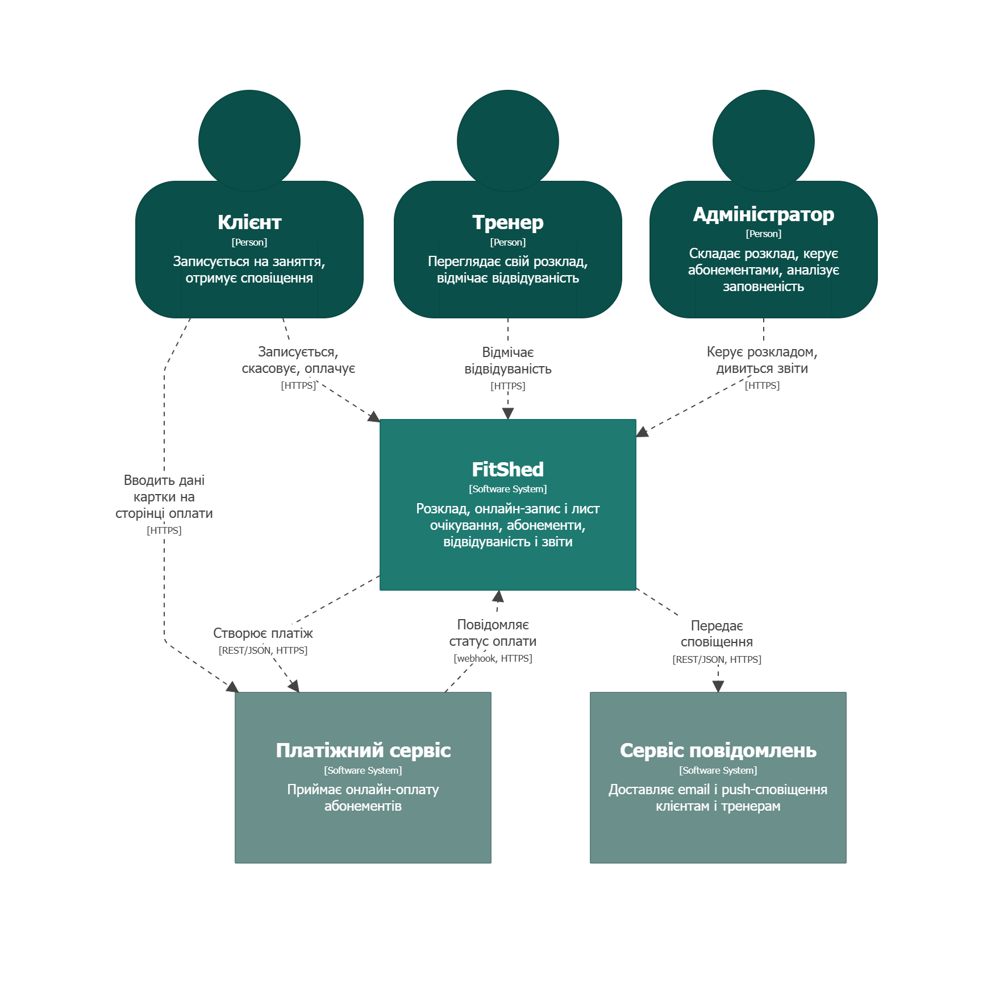
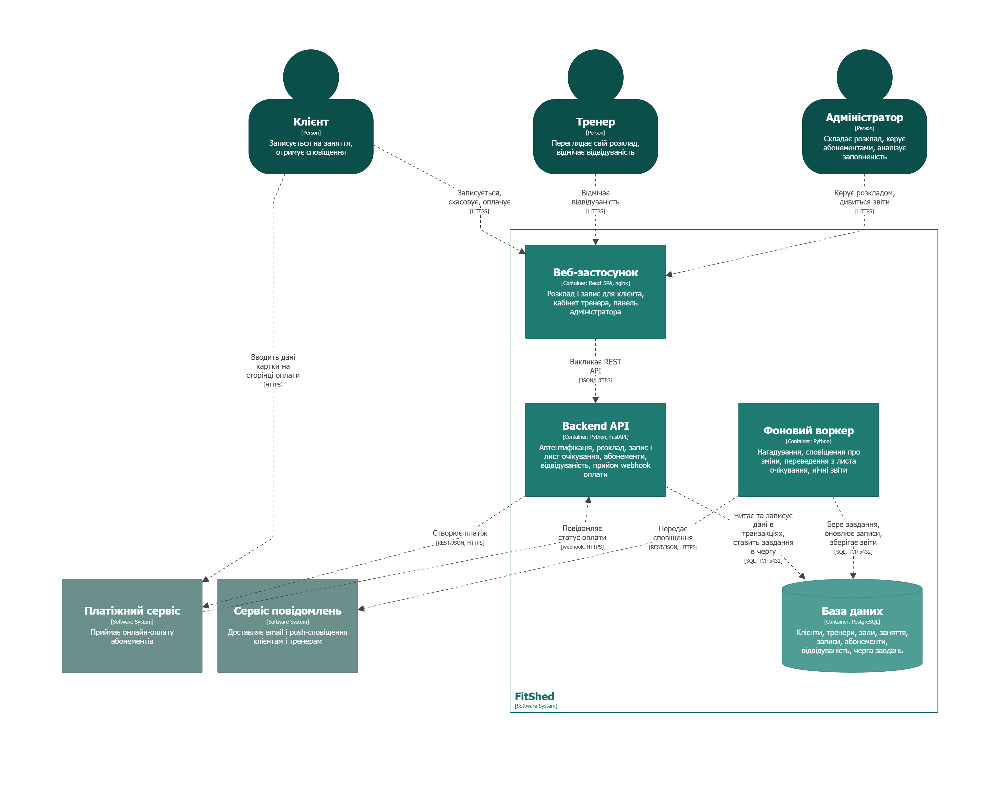

# FitShed — розклад і онлайн-запис для фітнес-центру
 
| Робота | Тема | Де |
|---|---|---|
| №1 | Вимоги, архітектурні стилі та C4 | цей README, `docs/architecture`, `docs/adr` |
| №2 | DDD і доменне ядро з портами й адаптерами | [`docs/lab2/README.md`](docs/lab2/README.md), `backend/` |
| №3 | Взаємодія компонентів і узгодженість даних. Патерн Saga | [`docs/lab3/README.md`](docs/lab3/README.md), `backend/src/fitshed/saga/` |
 
## Структура репозиторію
 
| Шлях | Що там |
|---|---|
| `README.md` | Опис системи, вимоги, сценарії якості, висновок |
| `docs/architecture/workspace.dsl` | Модель C4 у Structurizr DSL (вихідний файл діаграм) |
| `docs/architecture/exports/` | Експорт діаграм у PNG |
| `docs/adr/ADR-001-modular-monolith.md` | Рішення про архітектурний стиль (уточнене в ЛР2)|
| `docs/adr/ADR-002-booking-saga.md` | Рішення про оркестровану Saga для запису з абонементом (ЛР 3) |
| `docs/lab2/` | Карта контекстів, доменна модель, словник, результати тестів (ЛР 2) |
| `docs/lab3/` | Контракти, діаграма послідовності, результати перевірок Saga (ЛР 3) | 
| `backend/` | Доменне ядро, Saga та тести (ЛР 2–3) |
 
Діаграми описано як код у Structurizr DSL. Обидві діаграми (System Context і Container) будуються з однієї моделі, тому не можуть розійтися між собою.
 
Щоб переглянути діаграми, потрібно запустити Structurizr у Docker з кореня репозиторію:
 
```
docker run -it --rm -p 8080:8080 -v ${PWD}/docs/architecture:/usr/local/structurizr structurizr/structurizr local
```
 
і відкрити `http://localhost:8080`. Подвійний клік по FitShed на діаграмі контексту відкриває діаграму контейнерів. PNG у папці `exports` експортовано зі Structurizr.


### Демонстрація Saga (ЛР 3)   

```
cd backend/src
python -m fitshed.saga.demo
```

Скрипт виконує чотири перевірки й для кожної виводить початковий стан, журнал, кінцевий стан і результат автоматичної перевірки.
 
---
 
## 1. Проблема
 
Як приклад узято умовний фітнес-клуб: близько 600 постійних клієнтів, 12 тренерів, три зали і приблизно 40 групових занять на тиждень. Клієнти записуються через ресепшн, по телефону та в месенджерах. Розклад ведеться в Excel і дублюється на папері біля входу, а облік абонементів — в окремій таблиці.
 
Через це в клубі постійні проблеми. На одні заняття всі не вміщуються, на інших порожньо. Клієнтам незручно скасувати запис, тож вони просто не приходять, і місце пропадає. Про зміни в розкладі повідомляють вручну і не завжди вчасно. Адміністрація не бачить реальних даних про відвідуваність і складає розклад «на око».
 
FitShed збирає розклад, запис, абонементи й відвідуваність в одній системі. Клієнт сам записується чи скасовує запис за кілька секунд, звільнене місце автоматично отримує наступний з листа очікування, а про зміни всі дізнаються одразу. Адміністрація отримує звіти про заповненість занять і навантаження тренерів.
 
## 2. Межі системи
 
**Входить у систему:**
- розклад групових та індивідуальних занять із прив'язкою до залу й тренера;
- онлайн-запис, скасування та лист очікування;
- абонементи (строк дії, кількість відвідувань) і їх списання;
- відмітка відвідуваності тренером;
- нагадування та сповіщення про зміни розкладу;
- звіти про заповненість занять і навантаження тренерів.

**Не входить у систему (зовнішнє або поза обсягом):**
- проведення оплати й зберігання даних карток: цим займається зовнішній платіжний сервіс;
- доставка листів і push-повідомлень: зовнішній сервіс повідомлень;
- бухгалтерія, зарплата тренерів, складський облік (вода, спортивне харчування);
- турнікети й пропускна система;
- нативний мобільний застосунок (веб-інтерфейс адаптивний, тож ним зручно користуватися з телефону).

## 3. Ролі користувачів
 
| Роль | Хто це | Що робить у системі |
|---|---|---|
| Клієнт | Відвідувач клубу | Переглядає розклад, записується й скасовує запис, стає в лист очікування, купує абонемент, отримує нагадування |
| Тренер | Співробітник, що проводить заняття | Бачить свій розклад і список записаних, відмічає присутніх, повідомляє про неможливість провести заняття |
| Адміністратор | Співробітник ресепшн або керівник | Складає розклад, керує залами, тренерами й абонементами, скасовує чи переносить заняття, переглядає звіти |
 
## 4. Сценарії використання
 
**СВ-1. Запис на групове заняття з листом очікування** (Клієнт)
1. Клієнт відкриває розклад і обирає заняття, наприклад «Пілатес, середа 19:00».
2. Система перевіряє, чи є вільні місця і чи діє абонемент.
3. Якщо місце є, запис підтверджується, а з абонемента резервується одне відвідування.
4. Якщо місць немає, клієнт може стати в лист очікування.
5. Коли хтось скасовує запис, воркер автоматично записує першого з листа і надсилає йому сповіщення.
Альтернатива: скасування пізніше ніж за 3 години до початку не повертає відвідування в абонемент.
 
**СВ-2. Скасування заняття та сповіщення записаних** (Адміністратор)
1. Тренер захворів, і адміністратор скасовує заняття або призначає іншого тренера.
2. Система змінює розклад і повертає відвідування в абонементи записаних.
3. Воркер надсилає сповіщення всім записаним і тим, хто в листі очікування.
4. На сторінці розкладу заняття позначено як скасоване чи змінене.

**СВ-3. Відмітка відвідуваності** (Тренер)
1. На початку заняття тренер відкриває список записаних на телефоні.
2. Відмічає, хто прийшов, а кого немає.
3. Відвідування списується з абонемента, а пропуск фіксується для статистики.

**СВ-4. Аналіз заповненості та зміна розкладу** (Адміністратор)
1. Щоночі воркер формує звіт про заповненість занять і навантаження тренерів за тиждень.
2. Адміністратор бачить, що «Стретчинг у понеділок 10:00» заповнений у середньому на 25 %, а «Функціональний тренінг» у вівторок і четвер 19:00 щоразу має лист очікування.
3. Він переносить слабке заняття на інший час і додає ще один функціональний тренінг.

## 5. Суттєва та випадкова складність
 
**Суттєва складність** — та, що випливає з самої предметної області. Її неможливо прибрати, можна лише акуратно організувати.
 
1. **Обмежені місця й одночасний запис.** У залі групових програм обмежена кількість місць, а на популярні заняття багато людей записуються одночасно, щойно відкривається розклад. Не можна допустити, щоб останнє місце отримали двоє. До цього додаються лист очікування, правила пізнього скасування й автоматичне переведення з листа на звільнене місце.
2. **Розклад з обмеженнями та абонементи з різними правилами.** Тренер не може вести два заняття одночасно, у залі не може бути двох занять, місткість залів різна. Абонементи бувають на кількість відвідувань чи на строк, деякі не діють на певні типи занять, їх можна заморозити. Будь-яка зміна розкладу зачіпає вже записаних клієнтів.

**Випадкова складність** — та, яку розробники додають самі через інструменти й рішення, без потреби з боку задачі.
 
1. **Розподілена архітектура «на виріст».** Окремі мікросервіси для розкладу, запису, абонементів і сповіщень, брокер повідомлень. Тоді запис на заняття (перевірити місце, списати абонемент, зберегти запис) розтягнувся б на кілька сервісів і баз, і довелося б вигадувати розподілені транзакції.
   *Як зменшено:* модульний моноліт з однією базою (див. [ADR-001](docs/adr/ADR-001-modular-monolith.md)). Запис виконується в одній транзакції PostgreSQL. Черга фонових завдань зберігається в таблиці тієї ж бази, тому окремий брокер (Redis, RabbitMQ) не потрібен.
2. **Окремі клієнти для кожної платформи та ручна конфігурація.** Окремі нативні застосунки для Android та iOS, різні версії Python і PostgreSQL у розробника та на сервері, паролі в коді, діаграми, намальовані вручну, які швидко застарівають.
   *Як зменшено:* один адаптивний веб-застосунок для всіх ролей; бекенд і воркер на одній мові з однією кодовою базою; налаштування лише через змінні оточення; діаграми як код у Git поруч із системою.

## 6. Сценарії якості
 
Кожен сценарій описано за шістьма частинами: джерело, стимул, середовище, об'єкт, реакція, вимірюваний критерій.
 
### СЯ-1. Узгодженість: одночасний запис на останні місця
 
| Частина | Значення |
|---|---|
| Джерело | 20 клієнтів |
| Стимул | Одночасно (протягом 1 секунди) записуються на заняття, де залишилося 3 вільні місця |
| Середовище | Звичайна робота, пікова година відкриття запису |
| Об'єкт | Backend API та база даних (модуль запису) |
| Реакція | Рівно 3 клієнти отримують підтвердження, решті пропонується лист очікування |
| Критерій | У 100 прогонах тесту 0 випадків, коли записаних більше за місткість; кожен абонемент списано не більше одного разу |
 
**Перевірка:** інтеграційний тест на pytest, який через `asyncio` та `httpx` надсилає 20 паралельних запитів на заняття з 3 місцями й повторюється 100 разів. Після кожного прогону тест рахує записи в базі та залишки абонементів.
 
### СЯ-2. Своєчасність сповіщень про зміну розкладу
 
| Частина | Значення |
|---|---|
| Джерело | Адміністратор |
| Стимул | Скасовує заняття, на яке записано 25 клієнтів і ще 5 стоять у листі очікування |
| Середовище | Звичайна робота; сервіс повідомлень може тимчасово повертати помилки |
| Об'єкт | Фоновий воркер |
| Реакція | Воркер надсилає сповіщення всім 30 людям; при помилці повторює спробу з паузою |
| Критерій | 100 % сповіщень передано сервісу повідомлень не пізніше ніж за 5 хвилин після скасування; якщо сервіс був недоступний до 10 хвилин, жодне сповіщення не втрачається і не дублюється |
 
**Перевірка:** тест із заглушкою сервісу повідомлень, яка записує час отримання кожного повідомлення, а в другому варіанті тесту 10 хвилин повертає 503. Порівнюються час скасування та час доставки, а також кількість повідомлень на кожного адресата.
 
### СЯ-3. Продуктивність у пікові години
 
| Частина | Значення |
|---|---|
| Джерело | Клієнти клубу |
| Стимул | Переглядають розклад на тиждень і записуються на заняття |
| Середовище | Вечірній пік (18:00–20:00), 100 одночасних користувачів, у базі розклад на 3 місяці |
| Об'єкт | Backend API та база даних |
| Реакція | Розклад і результат запису повертаються користувачу |
| Критерій | p95 часу відповіді не більше 500 мс, помилок менше 1 % |
 
**Перевірка:** навантажувальний тест у Locust (100 віртуальних користувачів, 10 хвилин, 80 % запитів на перегляд і 20 % на запис). Звіт Locust показує p95 і частку помилок.
 
### Як уточнено неперевірювану вимогу
 
У Project Charter проблема звучала так: «клієнти мають своєчасно дізнаватися про зміни розкладу». За цим формулюванням неможливо перевірити, виконано вимогу чи ні: незрозуміло, що таке «своєчасно», про які саме зміни йдеться і що має відбуватися, якщо сервіс повідомлень не працює. У СЯ-2 вимогу уточнено: конкретна подія (скасування заняття), конкретна кількість адресатів, межа 5 хвилин і поведінка під час збою.
 
## 7. Архітектура (C4)
 
### System Context
 

 
Система має три ролі користувачів і дві зовнішні системи. Дані картки клієнт вводить на сторінці платіжного сервісу, тож FitShed їх ніколи не отримує й не зберігає.
 
### Container
 

 
| Контейнер | Технологія | Відповідальність |
|---|---|---|
| Веб-застосунок | React SPA, nginx | Інтерфейс для клієнта, тренера й адміністратора; сам не зберігає даних |
| Backend API | Python, FastAPI | Автентифікація й ролі, розклад, запис і лист очікування, абонементи, відвідуваність; приймає webhook від платіжного сервісу; ставить фонові завдання |
| Фоновий воркер | Python | Нагадування перед заняттям, сповіщення про зміни, переведення з листа очікування, нічні звіти |
| База даних | PostgreSQL | Усі дані системи та черга фонових завдань |
 
Контейнер C4 тут означає окремий застосунок або сховище даних, а не обов'язково Docker-контейнер. Те, що кожен із них потім стане Docker-контейнером, є окремим рішенням про розгортання.
 
### Як вимоги вплинули на структуру
 
- **СЯ-1 (одночасний запис)** вимагає, щоб перевірка місць, списання абонемента та створення запису відбувалися в **одній транзакції** з блокуванням рядка заняття (`SELECT ... FOR UPDATE`). Тому запис і абонементи живуть в одному модулі однієї бази, а не в окремих сервісах. Це головний аргумент за модульний моноліт.
- **СЯ-2 (сповіщення за 5 хвилин)** привела до окремого **фонового воркера**. API лише фіксує зміну й ставить завдання в чергу в тій самій транзакції, а розсилкою та повторами займається воркер. Через це адміністратор не чекає, поки надішлеться 30 повідомлень, а збій сервісу повідомлень не ламає скасування.
- **СЯ-3 (пікові години)** вплинула на те, що важкі звіти рахуються вночі у воркері, а не під час запиту, і на індекси за датою заняття й залом.
- **Захист персональних даних** (обмеження з Charter): база доступна лише API та воркеру, дані карток не потрапляють у систему.

## 8. Модульний моноліт чи мікросервіси
 
| Критерій | Модульний моноліт | Мікросервіси |
|---|---|---|
| Розгортання | Один образ для API та воркера, кілька процесів | Окремий образ і конвеєр на кожен сервіс |
| Запис на заняття | Одна транзакція в одній базі | Кілька сервісів, потрібна сага або компенсаційні дії |
| Взаємодія модулів | Виклик функцій усередині процесу | Мережеві виклики, таймаути, повтори, контракти |
| Налагодження | Один журнал, один процес | Потрібне розподілене трасування |
| Масштабування | API та воркер окремо, модулі разом | Кожен сервіс окремо |
| Незалежність команд | Низька, спільний реліз | Висока, кожна команда випускає свій сервіс |
| Підходить для FitShed зараз | Так: 1 розробник, 1 клуб, до 100 одночасних користувачів | Ні: складність значно більша за користь |
 
Рішення та умови його перегляду описано в [ADR-001](docs/adr/ADR-001-modular-monolith.md).
 
## 9. Висновок
 
У роботі обрано тему FitShed — систему розкладу та онлайн-запису для фітнес-центру — і визначено її межі: оплата й доставка повідомлень залишаються за зовнішніми сервісами. Описано три ролі (клієнт, тренер, адміністратор) та чотири сценарії використання.
 
Суттєва складність системи пов'язана з одночасним записом на обмежені місця й розкладом з багатьма обмеженнями. Випадкову складність зменшено модульним монолітом з однією базою, чергою завдань у PostgreSQL замість окремого брокера, одним адаптивним веб-застосунком і описом діаграм як коду.
 
Сформульовано три вимірювані сценарії якості з конкретними способами перевірки, а розмиту вимогу з Project Charter про «своєчасні сповіщення» уточнено до перевірюваного сценарію. Найбільше на структуру вплинули два сценарії: одночасний запис привів до однієї бази та транзакцій, тобто до моноліту, а сповіщення за 5 хвилин — до окремого фонового воркера. Діаграми C4 рівнів System Context і Container показують цю структуру, а ADR-001 фіксує вибір модульного моноліту та умови його перегляду.
 