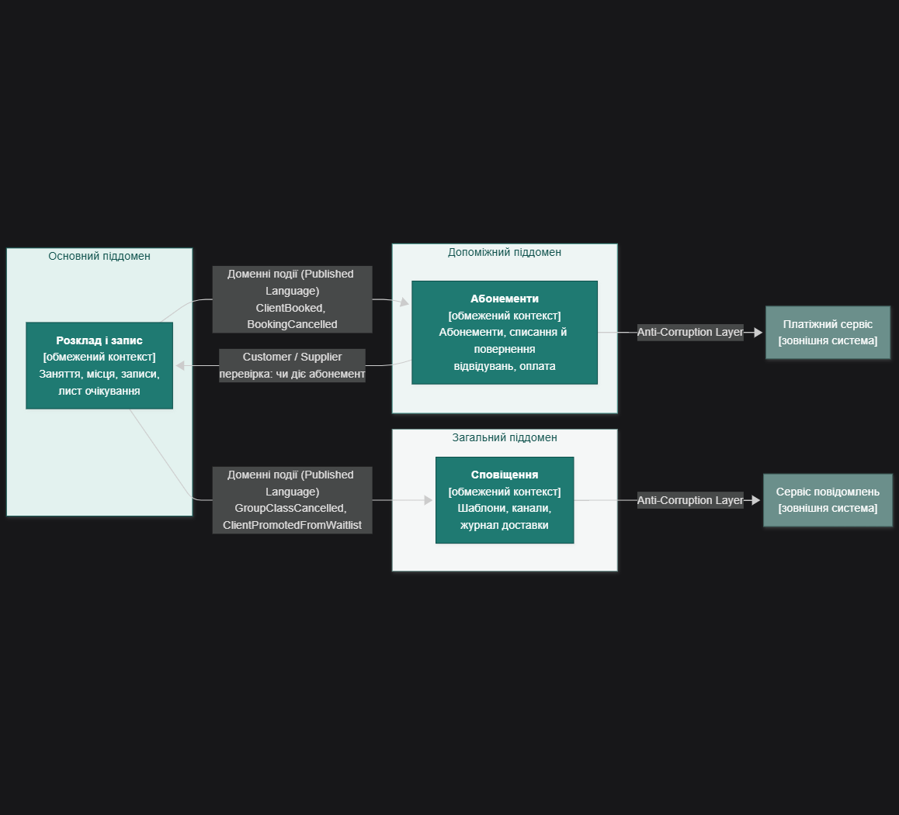
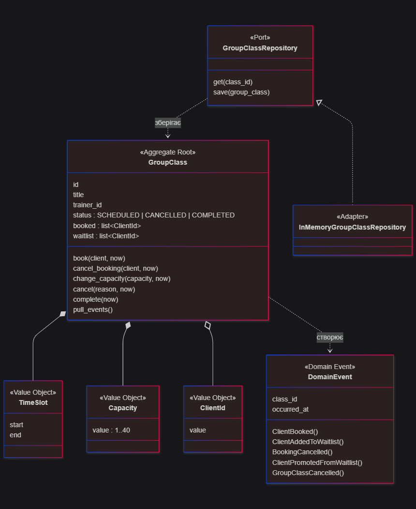
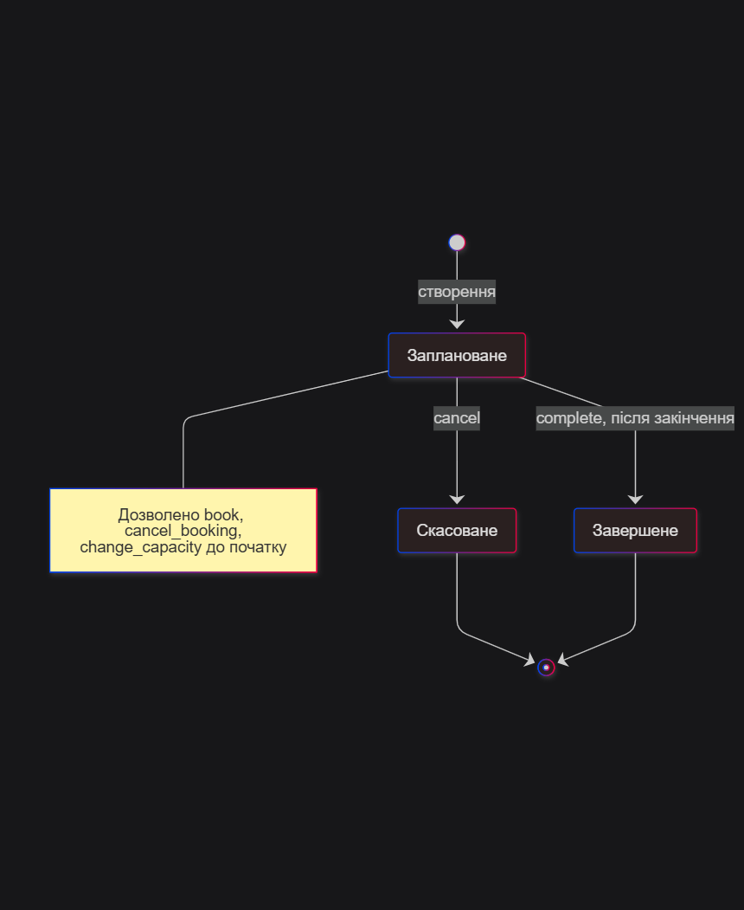

# Лабораторна робота №2. DDD і доменне ядро з портами й адаптерами

Система: **FitShed** (див. лабораторну №1). У цій роботі уточнено предметну модель, визначено обмежені контексти та реалізовано доменне ядро контексту «Розклад і запис».

## 1. Піддомени

| Піддомен | Тип | Чому саме такий |
|---|---|---|
| Розклад і запис на заняття | Основний (core) | Саме тут FitShed вирішує проблему клубу: записи без перевищення місць, лист очікування, скасування. Цього не можна просто купити готовим |
| Абонементи та оплата | Допоміжний (supporting) | Потрібен для роботи, але правила типові: строк дії, кількість відвідувань, заморозка |
| Сповіщення | Загальний (generic) | Однаковий для будь-якої системи; доставку виконує зовнішній сервіс |
| Автентифікація користувачів | Загальний (generic) | Стандартне завдання, вирішується готовими бібліотеками |

## 2. Обмежені контексти та їх взаємодія



Вихідний файл: [`context-map.mmd`](context-map.mmd).

| Контекст | За що відповідає | Що означає «клієнт» у цьому контексті |
|---|---|---|
| **Розклад і запис** | Заняття, місця, записи, лист очікування, скасування | Лише ідентифікатор того, хто займає місце |
| **Абонементи** | Абонементи, списання й повернення відвідувань, оплата | Власник абонемента з балансом відвідувань |
| **Сповіщення** | Шаблони повідомлень, канали, журнал доставки | Адресат з email і налаштуваннями сповіщень |

Слово «клієнт» в усіх трьох контекстах означає різне, і це нормально: кожен контекст має власну модель, яка узгоджена лише всередині нього.

**Як контексти взаємодіють:**
- **Абонементи → Розклад і запис (Customer / Supplier).** Перед записом прикладний сервіс запитує в «Абонементів», чи діє абонемент клієнта на цей тип заняття. Сам агрегат заняття про абонементи нічого не знає.
- **Розклад і запис → Абонементи (доменні події).** Після `ClientBooked` контекст «Абонементи» резервує відвідування, а після `BookingCancelled` повертає його, якщо скасування не пізнє (`late = False`).
- **Розклад і запис → Сповіщення (доменні події).** Події `GroupClassCancelled` і `ClientPromotedFromWaitlist` перетворюються на повідомлення клієнтам.
- **Anti-Corruption Layer.** Моделі платіжного сервісу та сервісу повідомлень не проникають у FitShed. Адаптери перекладають їхні формати в терміни контекстів.

Усі три контексти залишаються модулями одного застосунку (модульний моноліт з ADR-001), а не окремими мікросервісами.

## 3. Словник предметної області

| Термін | Англійською (у коді) | Значення |
|---|---|---|
| Групове заняття | `GroupClass` | Заняття за розкладом з тренером, залом, часом і обмеженою кількістю місць |
| Часовий інтервал | `TimeSlot` | Початок і кінець заняття; кінець завжди пізніше за початок |
| Кількість місць | `Capacity` | Скільки клієнтів може бути записано на заняття (від 1 до 40) |
| Запис | `booking` | Підтверджене місце клієнта на конкретному занятті |
| Лист очікування | `waitlist` | Черга клієнтів, які хочуть потрапити на заповнене заняття |
| Переведення з листа очікування | `promotion` | Автоматичний запис першого з черги на звільнене місце |
| Пізнє скасування | `late cancellation` | Скасування запису менш ніж за 3 години до початку; відвідування не повертається |
| Скасування заняття | `cancel` | Заняття не відбудеться (хвороба тренера, ремонт залу); усі записані отримують сповіщення |
| Завершене заняття | `COMPLETED` | Заняття, яке вже відбулося; змінювати його не можна |
| Абонемент | `membership` | Право відвідувати заняття: на строк або на кількість відвідувань |
| Відвідуваність | `attendance` | Відмітка тренера, хто реально прийшов на заняття |

## 4. Доменна модель



Вихідний файл: [`domain-model.mmd`](domain-model.mmd).

- **Агрегат і його корінь:** `GroupClass` (групове заняття). Записи та лист очікування існують лише всередині заняття й змінюються лише через його методи.
- **Об'єкти-значення:** `TimeSlot`, `Capacity`, `ClientId`. Вони незмінні (`frozen`), перевіряють себе при створенні й порівнюються за значенням.
- **Доменні події:** `ClientBooked`, `ClientAddedToWaitlist`, `BookingCancelled`, `ClientPromotedFromWaitlist`, `GroupClassCancelled`. Агрегат накопичує їх, а прикладний сервіс забирає через `pull_events()` після успішного збереження.

**Чому корінь саме «Заняття», а не «Запис».** Головне правило «записаних не більше, ніж місць» стосується всіх записів одного заняття разом. Окремий запис не знає, скільки ще людей записано, тому перевірити правило може лише об'єкт, який бачить усі записи та лист очікування, тобто заняття.

## 5. Бізнес-інваріанти

| № | Інваріант | Де перевіряється | Як його можна порушити (і що станеться) |
|---|---|---|---|
| 1 | Кінець заняття пізніше за початок, тривалість не більше 3 годин | `TimeSlot.__post_init__` | Створити `TimeSlot` з кінцем раніше початку → `InvalidValueError` |
| 2 | Кількість місць від 1 до 40 | `Capacity.__post_init__` | `Capacity(0)` або `Capacity(41)` → `InvalidValueError` |
| 3 | Записаних клієнтів не більше, ніж місць | `GroupClass.book`, `change_capacity`, `_check_invariants` | Записати четвертого на 3 місця → він потрапить у лист очікування; зменшити місця нижче кількості записаних → `InvariantViolationError` |
| 4 | Клієнт присутній на занятті лише один раз (серед записаних або в листі очікування) | `GroupClass.book`, `_check_invariants` | Записатися повторно → `InvariantViolationError` |
| 5 | Записи змінюються лише в запланованому занятті і до його початку | `GroupClass._ensure_bookings_can_change` | Записатися на скасоване чи вже розпочате заняття → `ForbiddenTransitionError` |

Метод `_check_invariants` викликається після кожної зміни як запобіжник. Якщо через помилку в коді правило буде порушено, агрегат кине виняток і не дасть зберегти неправильний стан.

## 6. Дозволені переходи стану



| Зі стану | У стан | Метод | Умова |
|---|---|---|---|
| Заплановане | Скасоване | `cancel(reason)` | будь-коли до завершення |
| Заплановане | Завершене | `complete(now)` | лише після закінчення заняття |
| Скасоване | будь-який | — | заборонено, кінцевий стан |
| Завершене | будь-який | — | заборонено, кінцевий стан |

Таблицю переходів задано в коді словником `ALLOWED_TRANSITIONS`, тож правило записане в одному місці.

## 7. Порти й адаптери

```
backend/src/fitshed/booking/
├── domain/                 # доменне ядро: без бази, API та UI
│   ├── value_objects.py    # TimeSlot, Capacity, ClientId
│   ├── group_class.py      # агрегат GroupClass, стани, інваріанти
│   ├── events.py           # доменні події
│   ├── errors.py           # доменні помилки
│   └── ports.py            # порт GroupClassRepository
├── adapters/
│   └── in_memory.py        # адаптер сховища в пам'яті
└── application/
    └── booking_service.py  # прикладний сервіс: завантажити → дія → зберегти
```

- **Порт** `GroupClassRepository` — абстрактний клас з методами `get` і `save`. Домен оголошує, що йому потрібно, але не каже, як це зроблено.
- **Адаптер** `InMemoryGroupClassRepository` зберігає копії агрегатів у словнику. Копіювання імітує справжню базу: зміни в отриманому об'єкті не потрапляють у сховище без `save()`.
- **Прикладний сервіс** `BookingService` отримує сховище ззовні. Пізніше той самий сервіс викликатиме FastAPI, а адаптер у пам'яті заміниться адаптером PostgreSQL. Доменний код при цьому не зміниться.

Незалежність ядра перевіряє окремий тест `test_domain_package_does_not_import_infrastructure`: він падає, якщо пакет `domain` імпортує адаптери, прикладний шар, FastAPI чи драйвери бази даних.

## 8. Тести

| Що вимагає завдання | Тести |
|---|---|
| Коректне створення | `test_new_class_is_scheduled_and_empty`, `test_time_slot_is_created_when_end_is_after_start` |
| Недопустиме значення | `test_time_slot_rejects_end_not_after_start`, `test_capacity_rejects_invalid_number_of_places`, `test_client_id_cannot_be_empty` |
| Порушення інваріанта | `test_capacity_cannot_be_reduced_below_booked_clients`, `test_same_client_cannot_book_twice` |
| Заборонений перехід | `test_cancelled_class_cannot_be_completed`, `test_completed_class_cannot_be_cancelled`, `test_cannot_book_cancelled_class` |
| Подія після успішної операції | `test_booking_adds_client_and_records_event`, `test_cancelling_booking_promotes_first_from_waitlist` |
| Збереження й отримання агрегату | `test_saved_class_can_be_loaded`, `test_changes_are_not_stored_until_save` |

Додатково перевірено, що невдала операція не створює подію, а ядро не залежить від інфраструктури.

**Як запустити** (з кореня репозиторію):

```
cd backend
python -m venv .venv
.venv\Scripts\activate        # Windows; на Linux/macOS: source .venv/bin/activate
pip install pytest
python -m pytest
```

Результат останнього запуску збережено у [`test-results.txt`](test-results.txt): **31 тест, усі пройшли**.

## 9. Обмеження реалізації

Реалізація не гарантує коректності за **конкурентних запитів**. Якщо два запити одночасно завантажать те саме заняття з 1 вільним місцем, кожен побачить вільне місце й збереже свою версію, і останній `save` перезапише перший. Агрегат перевіряє правила лише в межах одного об'єкта в пам'яті. Адаптер у пам'яті не має блокувань і не перевіряє версію.

Цю проблему розв'яже адаптер PostgreSQL: блокування рядка заняття (`SELECT ... FOR UPDATE`) в одній транзакції або поле версії для оптимістичного блокування. Саме для цього в ADR-001 обрано одну базу даних, а сценарій якості СЯ-1 з лабораторної №1 вимагає навантажувального тесту на одночасний запис.

## 10. Висновок

Для FitShed виділено основний піддомен «Розклад і запис», допоміжний «Абонементи» та загальний «Сповіщення». Відповідно визначено три обмежені контексти. Вони взаємодіють через запит перевірки абонемента та доменні події, а із зовнішніми сервісами — через антикорупційний шар.

Реалізовано агрегат «Групове заняття» з об'єктами-значеннями `TimeSlot`, `Capacity`, `ClientId` і п'ятьма доменними подіями. Агрегат захищає п'ять правил, зокрема головне: записаних не більше, ніж місць. Заняття має три стани, з яких скасоване й завершене є кінцевими.

Сховище підключено через порт, а для тестів використано адаптер у пам'яті. 31 тест перевіряє створення, недопустимі значення, порушення інваріантів, заборонені переходи, формування подій і збереження. Доменне ядро не залежить ні від бази даних, ні від інтерфейсу, тому в наступних роботах його можна буде підключити до FastAPI та PostgreSQL без змін.
