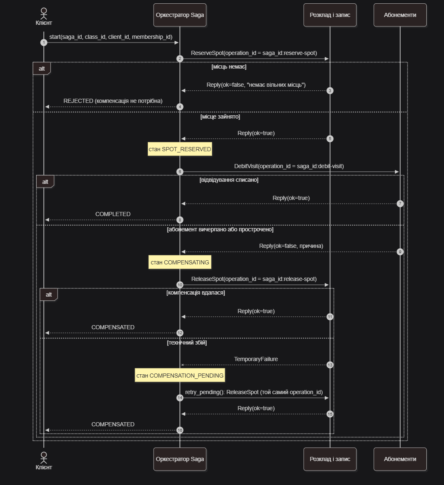
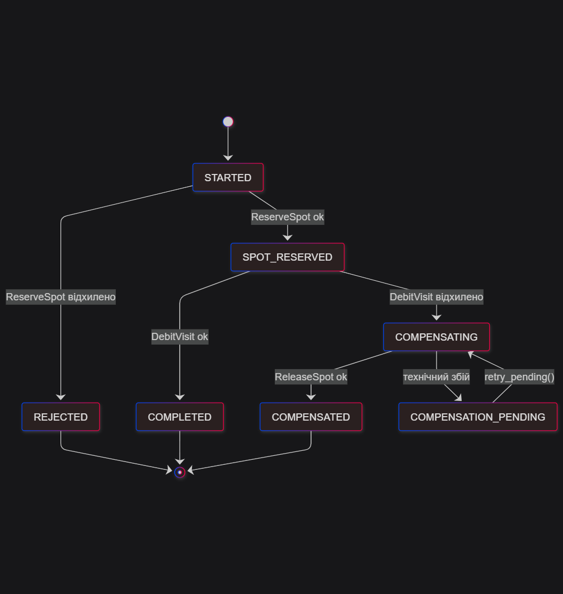

# Лабораторна робота №3. Взаємодія компонентів і узгодженість даних. Патерн Saga

Система: **FitShed**. Досліджується процес «запис на заняття з оплатою абонементом», який зачіпає два обмежені контексти з лабораторної №2.

## 1. Процес, учасники та власники даних

Коли клієнт записується на групове заняття, потрібно виконати дві локальні операції:
1. **зайняти місце на занятті** — контекст «Розклад і запис»;
2. **списати одне відвідування з абонемента** — контекст «Абонементи».

Обидві мають або виконатися разом, або не виконатися зовсім. Не можна, щоб клієнт зайняв місце без оплати або щоб відвідування списалося, а місця він не отримав.

Спільною транзакцією це не зробити, бо кожен контекст **сам володіє своїми даними** й не змінює чужих (правило з ADR-001 та ADR-002). Тому використано оркестровану Saga.

| Учасник | Контекст | Власні дані | Що робить у Saga |
|---|---|---|---|
| Оркестратор (`BookingSagaOrchestrator`) | прикладний шар | стан кожної Saga (`SagaState`) | керує порядком кроків і компенсацією |
| `BookingParticipant` | Розклад і запис | заняття, записи, лист очікування (агрегат `GroupClass` з ЛР 2) | крок 1 і компенсація |
| `MembershipParticipant` | Абонементи | абонементи, залишок відвідувань (агрегат `Membership`) | крок 2 |

Кожен учасник має **окреме сховище** й окремий список уже виконаних операцій. Оркестратор не змінює дані учасників напряму, а лише надсилає їм команди.

**Компенсація першої операції** — звільнити місце (`ReleaseSpot`). Це окрема бізнес-операція, а не «відкат»: вона створюється й виконується так само, як будь-яка інша команда, і теж може не вдатися.

## 2. Контракти команд

Кожна команда має **тип** (назва класу), **`operation_id`** (ідентифікатор саме цієї операції) і **`saga_id`** (до якого процесу вона належить). `operation_id` утворюється з `saga_id`, тому повтор того самого кроку завжди приходить з тим самим ідентифікатором.

| Команда | Учасник | Поля | Успіх | Бізнес-відмова | Технічний збій |
|---|---|---|---|---|---|
| `ReserveSpot` | Розклад і запис | `operation_id = <saga_id>:reserve-spot`, `saga_id`, `class_id`, `client_id` | клієнта записано, `Reply(ok=true)` | немає місць, заняття скасоване чи почалося, клієнт уже записаний: `Reply(ok=false, reason)` | — |
| `DebitVisit` | Абонементи | `operation_id = <saga_id>:debit-visit`, `saga_id`, `membership_id`, `class_id` | відвідувань стало на 1 менше, `Reply(ok=true)` | немає відвідувань, абонемент прострочений чи не знайдений: `Reply(ok=false, reason)` | `TemporaryFailure`, оркестратор повторює до 3 разів з тим самим `operation_id` |
| `ReleaseSpot` (компенсація) | Розклад і запис | `operation_id = <saga_id>:release-spot`, `saga_id`, `class_id`, `client_id` | місце звільнено (або клієнта вже не було серед записаних), `Reply(ok=true)` | — | `TemporaryFailure`, Saga переходить у `COMPENSATION_PENDING` |

**Відповідь** (`Reply`) містить `operation_id`, `ok` і `reason`. Бізнес-відмову (`ok=false`) повторювати безглуздо: абонемент від повтору не поповниться. Технічний збій (`TemporaryFailure`) означає, що операцію не виконано, і її можна повторити.

**Ідемпотентність.** Кожен учасник запам'ятовує пару «команда → відповідь» за `operation_id`. Якщо команда з тим самим `operation_id` приходить удруге, учасник не виконує її знову, а повертає збережену відповідь. Якщо `operation_id` той самий, а дані інші, це помилка відправника (`OperationConflictError`). Оркестратор так само ігнорує повторний запуск Saga з тим самим `saga_id`.

Код контрактів: [`backend/src/fitshed/saga/contracts.py`](../../backend/src/fitshed/saga/contracts.py).

## 3. Діаграма послідовності



Вихідний файл: [`sequence.mmd`](sequence.mmd).

## 4. Стани Saga



Вихідний файл: [`saga-states.mmd`](saga-states.mmd).

| Стан | Що означає |
|---|---|
| `STARTED` | процес розпочато, команд ще не надіслано |
| `SPOT_RESERVED` | крок 1 виконано, місце зайняте |
| `COMPLETED` | обидва кроки виконано |
| `REJECTED` | крок 1 відхилено, нічого не змінилося, компенсація не потрібна |
| `COMPENSATING` | крок 2 відхилено, виконується звільнення місця |
| `COMPENSATION_PENDING` | звільнити місце не вдалося через технічний збій, чекаємо на повтор |
| `COMPENSATED` | місце звільнено, система повернулася до узгодженого стану |

`COMPENSATION_PENDING` — це **явний стан очікування повтору**. Saga не «зависає» мовчки: видно, що вона незавершена і що місце поки зайняте без оплати. Метод `retry_pending()` повторює такі компенсації (у реальній системі його викликав би воркер за розкладом).

## 5. Реалізація

```
backend/src/fitshed/
├── booking/                  # контекст «Розклад і запис» (ЛР 2, без змін)
├── memberships/
│   └── domain/membership.py  # агрегат «Абонемент»
└── saga/
    ├── contracts.py          # команди, відповідь, типи помилок
    ├── participants.py       # учасники з ідемпотентністю та ін'єкцією збоїв
    ├── orchestrator.py       # оркестратор і стани Saga
    ├── journal.py            # діагностичний журнал
    ├── simulation.py         # збирає учасників і оркестратор для перевірок
    └── demo.py               # чотири перевірки з виводом станів і журналу
```

Учасник «Розклад і запис» повторно використовує агрегат `GroupClass` з ЛР 2, тож усі правила запису (місткість, повторний запис, стан заняття) діють і в Saga.

Для перевірок відмов учасники мають метод `fail_next(тип_команди, times)`: наступні `times` команд цього типу дають технічний збій.

## 6. Перевірки

Кожна перевірка виконується двічі:
- **демонстраційним скриптом**, який виводить початковий стан, журнал, кінцевий стан і результат автоматичної перевірки. Повний вивід: [`saga-results.txt`](saga-results.txt);
- **тестами pytest** у `backend/tests/test_saga.py`. Результат: [`test-results.txt`](test-results.txt).

### Перевірка 1. Успішний процес

| | Записані на заняття | Вільних місць | Відвідувань на абонементі |
|---|---|---|---|
| Початковий стан | — | 3 | 5 |
| Кінцевий стан | anna | 2 | 4 |

Журнал: `ReserveSpot: успішно` → `SPOT_RESERVED` → `DebitVisit: успішно` → `COMPLETED`.

Автоматична перевірка: статус `COMPLETED`, Анна записана, списано рівно одне відвідування.

### Перевірка 2. Відмова другого кроку з компенсацією

| | Записані на заняття | Вільних місць | Відвідувань на абонементі |
|---|---|---|---|
| Початковий стан | — | 3 | 0 |
| Кінцевий стан | — | 3 | 0 |

Журнал: `ReserveSpot: успішно` → `SPOT_RESERVED` → `DebitVisit: відмова: На абонементі не залишилося відвідувань` → `COMPENSATING` → `ReleaseSpot: успішно` → `COMPENSATED`.

Автоматична перевірка: статус `COMPENSATED`, обидва учасники повернулися до початкового стану.

### Перевірка 3. Повтор команд без повторного ефекту

Після успішного процесу ще раз запускається Saga з тим самим `saga_id`, а потім учасникам повторно надсилаються `ReserveSpot` і `DebitVisit` з тими самими `operation_id`. Так виглядала б ситуація, коли мережа доставила команди двічі.

| | Записані на заняття | Вільних місць | Відвідувань на абонементі |
|---|---|---|---|
| Початковий стан | — | 3 | 5 |
| Після першого виконання | anna | 2 | 4 |
| Кінцевий стан (після повторів) | anna | 2 | 4 |

Журнал: після `COMPLETED` йдуть записи «повторний запуск, нічого не роблю» та двічі «повтор, повертаю попередній результат без нового ефекту».

Автоматична перевірка: стан після повторів збігається зі станом після першого виконання, відвідування списано один раз.

### Перевірка 4. Помилка компенсації з подальшим повтором

Перед запуском учаснику «Розклад і запис» задано один технічний збій для `ReleaseSpot`.

| | Статус Saga | Записані на заняття | Вільних місць | Відвідувань |
|---|---|---|---|---|
| Початковий стан | — | — | 3 | 0 |
| Після невдалої компенсації | `COMPENSATION_PENDING` | anna | 2 | 0 |
| Кінцевий стан (після `retry_pending`) | `COMPENSATED` | — | 3 | 0 |

Журнал: `DebitVisit: відмова` → `COMPENSATING` → `ReleaseSpot: технічний збій` → `COMPENSATION_PENDING` → «повтор компенсації» → `ReleaseSpot: успішно` → `COMPENSATED`.

Автоматична перевірка: після першої спроби Saga явно чекає повтору, місце тимчасово зайняте, після повтору Saga скомпенсована з двох спроб, місце звільнене.

### Додаткові тести

- Відмова першого кроку (немає місць) не потребує компенсації і не зачіпає абонемент.
- Технічний збій списання повторюється з тим самим `operation_id`, а відвідування списується лише один раз.
- Повторна компенсація не має додаткового ефекту.
- Той самий `operation_id` з іншими даними відхиляється.
- Компенсація лишається в `COMPENSATION_PENDING`, поки збої тривають.
- Перезапуск оркестратора втрачає незавершену компенсацію (див. розділ 8).

## 7. Як запустити

Демонстрація чотирьох перевірок (з кореня репозиторію):

```
cd backend/src
python -m fitshed.saga.demo
python -m fitshed.saga.demo --save ../../docs/lab3/saga-results.txt
```

Друга команда ще й зберігає вивід у файл у кодуванні UTF-8.

Тести:

```
cd backend
python -m pytest tests/test_saga.py
```

## 8. Обмеження після перезапуску процесу

Симуляція працює в одному процесі, і **весь стан зберігається лише в оперативній пам'яті**. Після перезапуску втратиться:

- **стан усіх Saga в оркестраторі.** Якщо Saga була в `COMPENSATION_PENDING`, після перезапуску про неї ніхто не пам'ятає, `retry_pending()` нічого не знайде, і місце лишиться зайнятим без оплати назавжди. Це перевіряє тест `test_restart_of_orchestrator_loses_pending_compensation`;
- **списки виконаних `operation_id` в учасниках.** Ідемпотентність перестане працювати: команда, повторена після перезапуску, виконається вдруге;
- **дані самих учасників** (заняття та абонементи), бо адаптери тримають їх у пам'яті;
- **діагностичний журнал.**

Також симуляція не перевіряє мережеву доставку: виклики учасників — це звичайні виклики функцій, тож немає таймаутів і втрачених або переплутаних повідомлень. Технічний збій моделюється так, ніби операцію гарантовано не виконано. У реальній мережі після таймауту невідомо, чи виконалася операція, і саме тому повтор з тим самим `operation_id` там ще важливіший.

У реальній системі стан Saga, оброблені `operation_id` і дані учасників зберігалися б у PostgreSQL. Для повтору компенсацій воркер перевіряв би таблицю Saga за розкладом.

## 9. Висновок

Для FitShed обрано процес «запис на заняття з абонементом» з двох локальних операцій у різних контекстах: зайняти місце і списати відвідування. Компенсацією першої операції є звільнення місця. Описано контракти трьох команд з `operation_id` і `saga_id`, побудовано діаграму послідовності та діаграму станів Saga.

Реалізовано локальну симуляцію оркестрованої Saga, де кожен учасник має окреме сховище і власний список виконаних операцій. Чотири перевірки показали, що успішний процес змінює обох учасників, відмова другого кроку повертає систему до початкового стану через компенсацію, повтор команд не дає додаткового ефекту завдяки `operation_id`, а невдала компенсація переходить у явний стан `COMPENSATION_PENDING` і завершується після повтору.

Головне обмеження симуляції полягає в тому, що весь стан зберігається в пам'яті і після перезапуску втрачається разом з незавершеними компенсаціями. Тому в наступних роботах стан Saga та оброблені операції потрібно зберігати в базі даних.
