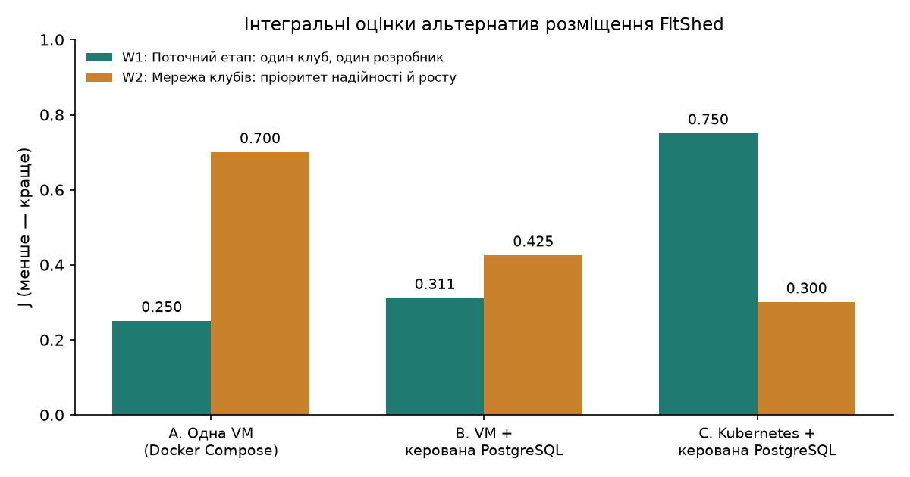

# Лабораторна робота №4. Оцінювання архітектури та багатометриковий вибір конфігурації

Система: **FitShed**. У роботі оцінено архітектурні ризики за двома сценаріями якості з ЛР 1 та обрано спосіб розміщення системи за кількома критеріями.

## 1. Аналіз ризиків за сценаріями якості (за мотивами ATAM)

Для аналізу взято два сценарії з ЛР 1, які найбільше вплинули на структуру системи.

### СЯ-1. Одночасний запис на останні місця

> 20 клієнтів одночасно записуються на заняття з 3 вільними місцями. Записаних має бути рівно 3 у 100 прогонах тесту.

| Елемент | Зміст |
|---|---|
| Архітектурне рішення | Модульний моноліт з однією базою PostgreSQL (ADR-001); правила запису захищає агрегат `GroupClass` (ЛР 2); запис з оплатою абонементом виконується оркестрованою Saga (ADR-002, ЛР 3) |
| Ризик | Агрегат перевіряє правила лише в межах одного об'єкта в пам'яті. Два одночасні запити можуть завантажити заняття з 1 вільним місцем, і обидва збережуть свою версію. У ЛР 2 це прямо зафіксовано як обмеження: адаптер у пам'яті не має блокувань. Тести ЛР 2 (31 тест) виконуються послідовно, тому одночасний запис ще не перевірено |
| Чутливий параметр | Спосіб блокування заняття в PostgreSQL: песимістичне блокування рядка (`SELECT ... FOR UPDATE`) або оптимістичне з полем версії |
| Точка компромісу | **Узгодженість ↔ продуктивність (СЯ-3).** Блокування рядка гарантує, що місце не продадуть двічі, але запити на одне популярне заняття виконуються по черзі. У вечірній пік це підвищує p95 саме для таких занять. Оптимістичне блокування не змушує чекати, але частина запитів отримає конфлікт і має повторитися |
| Другий компроміс | **Узгодженість ↔ незалежність модулів.** Saga з ЛР 3 зберігає власність даних модулів, але між кроками система тимчасово неузгоджена: місце вже зайняте, а відвідування ще не списано. Одна транзакція на два модулі прибрала б цю неузгодженість, але порушила б межі контекстів |
| Що вже перевірено | ЛР 2: інваріант «записаних не більше, ніж місць» у послідовних тестах; ЛР 3: повтор команд не дає подвійного списання (перевірка 3), відмова другого кроку повертає місце (перевірка 2) |

### СЯ-2. Сповіщення про скасування заняття за 5 хвилин без втрат

> Адміністратор скасовує заняття з 25 записаними та 5 у листі очікування. Усі 30 сповіщень передаються сервісу повідомлень за 5 хвилин, навіть якщо він до 10 хвилин недоступний.

| Елемент | Зміст |
|---|---|
| Архітектурне рішення | Окремий фоновий воркер; завдання записуються в таблицю черги в PostgreSQL у тій самій транзакції, що й зміна розкладу (ADR-001); повтори з паузою; невдалі операції переходять у явний стан очікування повтору (ЛР 3) |
| Ризик | 1) Якщо стан незавершених процесів зберігається лише в пам'яті, після перезапуску він губиться. ЛР 3 це показала тестом `test_restart_of_orchestrator_loses_pending_compensation`: незавершена компенсація зникає, місце лишається зайнятим. 2) PostgreSQL — єдина точка відмови: якщо сервер з базою впаде, черга завдань недоступна, і межа в 5 хвилин не виконається |
| Чутливий параметр | Інтервал опитування черги воркером і пауза між повторами. Від нього напряму залежить, чи вкладеться доставка у 5 хвилин |
| Точка компромісу | **Своєчасність ↔ навантаження на базу.** Короткий інтервал (наприклад, 5 с) дає швидку доставку, але воркер постійно опитує PostgreSQL, яка в пік обслуговує ще й запис (СЯ-3). Довгий інтервал (наприклад, 2 хв) зменшує навантаження, але разом із повторами ризикує вийти за 5 хвилин |
| Другий компроміс | **Простота ↔ пропускна здатність черги.** Черга в PostgreSQL усунула окремий брокер (менше випадкової складності, ЛР 1), але за великої кількості сповіщень спеціалізований брокер упорався б краще |
| Що вже перевірено | ЛР 3: технічний збій кроку повторюється з тим самим `operation_id` і не дає подвійного ефекту; невдала компенсація переходить у `COMPENSATION_PENDING` і завершується після повтору |

### Висновок для вибору розміщення

Обидва сценарії зводяться до однієї слабкої точки: **база даних і сервер, на якому вона працює**. Від того, як швидко систему можна відновити після відмови сервера, залежить виконання СЯ-2, а від запасу ресурсів залежить СЯ-1 у пік. Тому саме ці властивості стали критеріями наступного кроку.

## 2. Альтернативи розміщення

| | Альтернатива | Опис |
|---|---|---|
| **A** | Одна VM, Docker Compose | Усі чотири контейнери C4 (веб, API, воркер, PostgreSQL) на одній віртуальній машині. Дані бази в Docker volume, щоденна резервна копія |
| **B** | VM + керована PostgreSQL | Веб, API і воркер на VM у Docker Compose; база — керований сервіс провайдера з автоматичними копіями та резервною реплікою |
| **C** | Керований Kubernetes + керована PostgreSQL | Веб, API і воркер як Deployment у керованому кластері з кількома вузлами й автомасштабуванням; база — керований сервіс |

Логічна архітектура (контейнери C4 з ЛР 1) в усіх трьох однакова. Відрізняється лише те, де і як вони запущені. Це не вибір між монолітом і мікросервісами: моноліт лишається монолітом у будь-якому з варіантів.

## 3. Критерії

| Критерій | Одиниці | Напрям | Походження значень |
|---|---|---|---|
| Витрати на інфраструктуру | умовні одиниці на місяць | мінімізувати | **синтетичні**: співвідношення «VM < VM + база < кластер + база», а не тарифи провайдера |
| Час відновлення після відмови сервера (RTO) | хвилини | мінімізувати | **синтетичні припущення**: A — підняти нову VM і відновити базу з копії вручну; B — підняти нову VM, база не постраждала; C — оркестратор сам перезапускає поди на іншому вузлі |
| Складність супроводу | бали від 1 до 5 | мінімізувати | **експертна оцінка автора**: скільки окремих технологій і налаштувань треба знати й підтримувати одному розробнику |
| Запас масштабування | одночасних користувачів без зміни архітектури | максимізувати | **синтетичні**: грубе припущення про межу однієї VM, VM з винесеною базою та кластера з автомасштабуванням |

**Жодне значення не є результатом вимірювання.** Виміряних показників розміщення в проєкті поки немає, бо систему ще не розгорнуто. Вихідні дані: [`evaluation/alternatives.csv`](../../evaluation/alternatives.csv), критерії та ваги: [`evaluation/criteria.json`](../../evaluation/criteria.json).

| Альтернатива | Витрати, ум. од./міс | RTO, хв | Складність, бали | Запас, користувачів |
|---|---|---|---|---|
| A | 25 | 60 | 1 | 150 |
| B | 55 | 15 | 2 | 300 |
| C | 140 | 5 | 5 | 2000 |

## 4. Розрахунок

Нормовані втрати для критерію, який мінімізують: `(value − min) / (max − min)`; для критерію, який максимізують: `(max − value) / (max − min)`. Мінімум і максимум беруться по фіксованій множині {A, B, C}. Якщо значення критерію в усіх альтернатив однакові, втрати дорівнюють 0 для всіх (у скрипті це перевірено тестом, хоча в наших даних такого випадку немає).

Інтегральна оцінка `J = Σ wₖ · lossₖ`, ваги невід'ємні й у сумі дають 1. Менше J — краще.

Розрахунок виконує скрипт [`evaluation/mcda.py`](../../evaluation/mcda.py). Повний звіт з усіма проміжними значеннями: [`results.md`](results.md).

### Нормовані втрати

| | Витрати | RTO | Складність | Запас |
|---|---|---|---|---|
| A | 0,000 | 1,000 | 0,000 | 1,000 |
| B | 0,261 | 0,182 | 0,250 | 0,919 |
| C | 1,000 | 0,000 | 1,000 | 0,000 |

Наприклад, втрати B за витратами: (55 − 25) / (140 − 25) = 0,261; втрати B за запасом: (2000 − 300) / (2000 − 150) = 0,919.

### Два набори ваг

| Набір | Пріоритети | Витрати | RTO | Складність | Запас |
|---|---|---|---|---|---|
| **W1** | поточний етап: один клуб, один розробник | 0,40 | 0,15 | 0,35 | 0,10 |
| **W2** | мережа клубів: надійність і ріст | 0,15 | 0,40 | 0,15 | 0,30 |

### Інтегральні оцінки

| | J за W1 | Місце | J за W2 | Місце |
|---|---|---|---|---|
| A | **0,250** | 1 | 0,700 | 3 |
| B | 0,311 | 2 | 0,425 | 2 |
| C | 0,750 | 3 | **0,300** | 1 |



Однакових мінімальних оцінок немає ні в одному наборі.

### Чому змінився вибір

За **W1** перемагає **A**. Найбільші ваги мають витрати й складність, а за ними A найкраща (втрати 0). Великі втрати A за RTO і запасом мають малі ваги (0,15 і 0,10).

За **W2** перемагає **C**. Тепер основна вага на RTO і запасі масштабування, де C найкраща, а A найгірша. Тому A опускається на останнє місце.

**B** в обох наборах друга. Вона ніде не найкраща, але й ніде не найгірша, крім запасу масштабування.

### Чутливість до ваг

A і B за W1 близькі (0,250 і 0,311). Якщо поступово переносити вагу з витрат на RTO, вибір змінюється вже при перенесенні 0,10:

| w(витрати) | w(RTO) | J(A) | J(B) | J(C) | Вибір |
|---|---|---|---|---|---|
| 0,40 | 0,15 | 0,250 | 0,311 | 0,750 | A |
| 0,35 | 0,20 | 0,300 | 0,307 | 0,700 | A |
| 0,30 | 0,25 | 0,350 | 0,303 | 0,650 | **B** |
| 0,25 | 0,30 | 0,400 | 0,299 | 0,600 | B |

Отже, перевага A нестійка: вона тримається лише доти, доки час відновлення справді менш важливий за гроші.

### Чутливість до множини кандидатів

Якщо прибрати C, змінюються мінімуми й максимуми нормування:

| Набір | J(A) | J(B) | Вибір |
|---|---|---|---|
| W1 | 0,250 | 0,750 | A |
| W2 | 0,700 | 0,300 | **B** |

За W2 без C перемагає B. Крім того, оцінка B за W1 зросла з 0,311 до 0,750, хоча її власні показники не змінилися: без дорогої C вона стала «найдорожчою» в множині. Тому оцінки мають сенс лише для конкретного набору кандидатів, і порівнювати J з різних наборів не можна.

## 5. Вигоди, витрати та складність (за мотивами CBAM)

| | A. Одна VM | B. VM + керована PostgreSQL | C. Kubernetes + керована PostgreSQL |
|---|---|---|---|
| **Вигоди для СЯ-1** | достатньо для одного клубу (до 100 одночасних користувачів за ЛР 1) | те саме + база не конкурує з API за ресурси | запас для мережі клубів, автомасштабування API |
| **Вигоди для СЯ-2** | слабкі: відмова VM зупиняє і воркер, і чергу; відновлення бази з копії вручну | краще: копії й репліка бази автоматичні, черга завдань переживає відмову VM | найкраще: воркер перезапускається автоматично, база керована |
| **Витрати ресурсів** | найменші | приблизно вдвічі більші за A | у кілька разів більші за B |
| **Складність супроводу** | Docker Compose, який і так потрібен для розробки | + налаштування доступу до керованої бази | + Kubernetes, маніфести, кластер, мережеві політики |
| **Що з'являється нового для ризику** | єдина точка відмови для всього | залежність від провайдера бази | складна платформа для одного розробника, нові типи збоїв |

### Припущення, які не перевірено

- Усі витрати є відносними оцінками, а не цінами конкретного провайдера.
- RTO для A (60 хв) передбачає, що щоденна резервна копія існує і відновлення з неї відпрацьоване. Якщо копії немає, втрачаються дані, і RTO не має сенсу.
- Межі запасу (150 / 300 / 2000 користувачів) не виміряно навантажувальним тестом. Потрібно виконати тест СЯ-3 у Locust.
- Оцінка складності суб'єктивна й залежить від досвіду розробника.
- Ваги W1 і W2 обрано автором, а не узгоджено з власником клубу.

## 6. Рішення

Обрано **A — одна VM з Docker Compose** для поточного етапу, з обов'язковими заходами проти головного ризику: щоденна резервна копія бази в окреме сховище та перевірка відновлення з неї. Перехід на B передбачено, щойно важливість часу відновлення зросте. Деталі, наслідки й умови перегляду: [ADR-003](../adr/ADR-003-deployment.md).

## 7. Як запустити

З кореня репозиторію:

```
python evaluation/mcda.py                                # розрахунок у консоль
python evaluation/mcda.py --save docs/lab4/results.md    # і збереження звіту
python -m pytest evaluation                              # перевірка формул (9 тестів)
```

Скрипт використовує лише стандартну бібліотеку Python. Для графіка потрібен matplotlib:

```
pip install matplotlib
python evaluation/chart.py
```

Результати тестів: [`test-results.txt`](test-results.txt).

## 8. Висновок

Аналіз сценаріїв СЯ-1 та СЯ-2 показав, що головні ризики FitShed пов'язані з базою даних. Одночасний запис ще не захищений блокуванням, а незавершені процеси без збереження в базі губляться після перезапуску (це підтвердили перевірки ЛР 2 і ЛР 3). Чутливими параметрами є спосіб блокування заняття та інтервал опитування черги, а основні компроміси — між узгодженістю й продуктивністю та між своєчасністю сповіщень і навантаженням на базу.

Три способи розміщення порівняно за чотирма критеріями з двома наборами ваг. За пріоритетів поточного етапу найкращою виявилася одна VM (J = 0,250), а за пріоритетів мережі клубів — Kubernetes з керованою базою (J = 0,300). Аналіз чутливості показав, що перевага одної VM нестійка: достатньо підвищити вагу часу відновлення на 0,10, і вибір переходить на VM з керованою базою. Зміна множини кандидатів теж змінює результат, тому оцінки порівнюються лише в межах одного набору.

Усі значення показників синтетичні, тому рішення в ADR-003 прийнято як рішення для поточного етапу з конкретними умовами перегляду, а не як остаточний вибір.

## 9. Підсумок проєкту

За чотири роботи для FitShed послідовно виконано:
1. **ЛР 1** — межі системи, ролі, сценарії якості, модель C4 і вибір модульного моноліту (ADR-001);
2. **ЛР 2** — обмежені контексти й доменне ядро «Розкладу і запису» з портом сховища та 31 тестом;
3. **ЛР 3** — оркестрована Saga «запис з абонементом» з компенсацією та ідемпотентністю (ADR-002);
4. **ЛР 4** — оцінювання ризиків і вибір розміщення (ADR-003).

Кожне наступне рішення спирається на попередні: сценарії якості з ЛР 1 визначили агрегат у ЛР 2, обмеження агрегату й Saga стали ризиками в ЛР 4, а ризики визначили критерії вибору розміщення.
