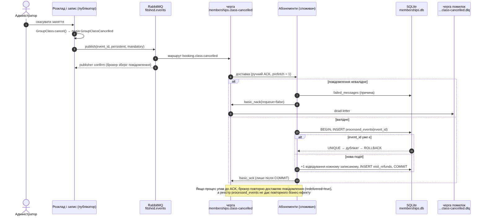

# Лабораторна робота №6 (модуль 2, ЛР 2). Подійна взаємодія та ідемпотентна обробка повідомлень
 
Система: **FitShed**. Контексти «Розклад і запис» та «Абонементи» з ЛР 2 обмінюються подією через локальний RabbitMQ. Споживач обробляє повторні доставки, збої й перезапуск без повторного бізнес-ефекту.
 
## 1. Подія та її споживач
 
**Факт:** групове заняття скасовано (`GroupClassCancelled`). Цю подію агрегат `GroupClass` створює ще з ЛР 2, коли адміністратор скасовує заняття.
 
**Споживач:** контекст «Абонементи». Кожному клієнту, який мав **місце** на скасованому занятті, він повертає одне відвідування на абонемент. Клієнтам з листа очікування нічого не повертається, бо вони відвідування не витрачали.
 
**Бізнес-результат**, який рахують перевірки: рядок у таблиці `visit_refunds` і +1 до `memberships.visits_left` для кожного записаного клієнта. Для заняття з трьома записаними очікуваний результат — **рівно 3 повернення**, скільки б разів подію не доставили.
 
**Подія, а не команда.** Публікатор не каже «поверни відвідування» (це був би намір, команда). Він повідомляє, що заняття вже скасовано, і не знає, хто на це реагуватиме. Повернення відвідувань — рішення «Абонементів». На ту саму подію згодом може реагувати й контекст «Сповіщення», нічого не змінюючи в публікаторі.
 
### Діаграма взаємодії
 

 
Вихідний файл: [`sequence.mmd`](sequence.mmd).
 
## 2. Схема події (версія 1)
 
```json
{
  "event_id": "5b1f6c1e-6a0e-4c43-9a8e-2f1d7d2a0c11",
  "event_type": "GroupClassCancelled",
  "schema_version": 1,
  "occurred_at": "2026-12-01T09:00:00",
  "aggregate_id": "cls-1a2b3c4d",
  "data": {
    "class_id": "cls-1a2b3c4d",
    "reason": "Тренер захворів",
    "booked_client_ids": ["anna", "bohdan", "vira"]
  }
}
```
 
| Поле | Обов'язкове | Призначення |
|---|---|---|
| `event_id` | так | унікальний ідентифікатор саме цієї події (UUID); за ним споживач розпізнає повтор |
| `event_type` | так | тип події; споживач приймає лише `GroupClassCancelled` |
| `schema_version` | так | версія схеми; підтримується `1`, інша версія — у чергу помилок |
| `occurred_at` | так | коли заняття скасовано (ISO 8601) |
| `aggregate_id` | так | ідентифікатор об'єкта — заняття |
| `data.class_id` | так | має збігатися з `aggregate_id` |
| `data.booked_client_ids` | так | кому повернути відвідування; без повторів |
| `data.reason` | ні | причина для журналу; споживачу для рішення не потрібна |
 
Перевірка схеми: [`envelope.py`](../../backend/src/fitshed/messaging/envelope.py). Список записаних береться зі стану агрегату на момент скасування, бо доменна подія з ЛР 2 містить записаних і лист очікування разом.
 
### Вимоги до порядку й застарілих подій
 
- **Порядок не важливий.** Скасування — кінцевий стан заняття, тож для одного заняття є лише одна подія. Події різних занять незалежні: повернення за заняття A не залежить від повернення за заняття B.
- **Застаріла подія допустима.** Якщо подія прийде із запізненням (наприклад, після збою), відвідування все одно треба повернути, бо факт скасування не змінюється. Клієнт отримає повернення пізніше, але отримає.
- **Повторна подія не повинна давати ефекту.** Від повтору захищають два рівні: реєстр `processed_events` (той самий `event_id`) та унікальний ключ `UNIQUE(class_id, client_id)` у `visit_refunds` (ту саму подію опублікували вдруге з новим `event_id`).
## 3. Стенд
 
### Конфігурація брокера
 
| Елемент | Налаштування | Навіщо |
|---|---|---|
| Exchange `fitshed.events` | topic, durable | вхідна точка подій; routing key `booking.class.cancelled` |
| Черга `memberships.class-cancelled` | durable, `x-dead-letter-exchange = fitshed.dlx` | черга споживача; відхилені повідомлення йдуть у чергу помилок |
| Exchange `fitshed.dlx` | direct, durable | маршрутизація відхилених повідомлень |
| Черга `memberships.class-cancelled.dlq` | durable | черга помилок для розбору |
| Повідомлення | `delivery_mode = 2` (persistent), `mandatory = true` | переживають перезапуск брокера; немаршрутизоване повідомлення дає помилку, а не тиху втрату |
| Публікатор | `confirm_delivery()` (publisher confirms) | публікація вважається успішною лише після підтвердження брокера |
| Споживач | `auto_ack = false`, `prefetch_count = 1` | ручний ACK лише після COMMIT; одне непідтверджене повідомлення за раз |
| Брокер | Docker Compose, том `rabbitmq-data` | дані брокера переживають перезапуск контейнера |
 
Файли: [`docker-compose.yml`](../../docker-compose.yml), [`.env.example`](../../.env.example), [`rabbitmq.py`](../../backend/src/fitshed/messaging/rabbitmq.py).
 
Облікові дані в прикладах синтетичні (`fitshed` / `fitshed-local-only`). Справжні значення задаються у файлі `.env`, який є в `.gitignore`.
 
### Сховище споживача (SQLite)
 
Файл `backend/var/memberships.db` (шлях можна змінити змінною `FITSHED_CONSUMER_DB`). Він переживає перезапуск споживача.
 
| Таблиця | Призначення |
|---|---|
| `memberships` | баланс відвідувань клієнтів |
| `processed_events` | реєстр оброблених подій, `event_id` — первинний ключ |
| `visit_refunds` | бізнес-результат: повернення, `UNIQUE(class_id, client_id)` |
| `failed_messages` | повідомлення, які не вдалося обробити, з причиною й кількістю спроб |
 
### Як обробляється одна доставка
 
[`consumer.py`](../../backend/src/fitshed/messaging/consumer.py):
1. Розібрати й перевірити повідомлення. Якщо воно невалідне, записати причину в `failed_messages` і виконати `basic_nack(requeue=false)`: брокер перенесе його в чергу помилок. Повторів немає, бо від повтору невалідне повідомлення не стане валідним.
2. В **одній транзакції** SQLite записати `event_id` у `processed_events`, повернення в `visit_refunds` і нові баланси. Якщо `event_id` уже є, спрацює первинний ключ, транзакція відкотиться, і результат буде `duplicate`.
3. За тимчасової помилки сховища (`sqlite3.OperationalError`, наприклад «database is locked») повторити до **3 спроб** із затримкою 0,5 с і 1 с. Після вичерпання спроб записати повідомлення й причину в `failed_messages` і відправити в чергу помилок. Нескінченного негайного `requeue` немає.
4. **ACK лише після COMMIT**, зокрема і для дубліката.
### Доменне ядро не залежить від брокера
 
Доменний код (`booking/domain`) не змінювався. Залежності йдуть так:
- `envelope.py`, `refunds.py`, `consumer.py`, `failpoints.py` — без бібліотеки брокера;
- `in_memory_broker.py` — імітація брокера для автоматичних тестів;
- `rabbitmq.py` — **єдиний** модуль, що імпортує `pika`.
Тест `test_domain_package_does_not_import_infrastructure` (ЛР 2) доповнено: тепер він забороняє доменному пакету імпортувати і `pika`, і `messaging`.
 
### Керовані точки збою
 
Задаються змінною оточення `FITSHED_FAILPOINT` ([`failpoints.py`](../../backend/src/fitshed/messaging/failpoints.py)):
 
| Значення | Що відбувається |
|---|---|
| `before_commit` | бізнес-зміни виконано, але процес «падає» до COMMIT |
| `after_commit_before_ack` | COMMIT виконано, але процес «падає» до ACK |
| `temporary_error:N` | перші N спроб запису дають тимчасову помилку |
 
На справжньому брокері процес-споживач при цьому завершується через `os._exit(3)`, без ACK і без закриття з'єднання, тобто як при реальному падінні.
 
## 4. Перевірки
 
Перевірки виконуються двома способами.
 
**А. Автоматичні тести на імітації брокера** (`backend/tests/test_events.py`, 14 тестів). Імітація відтворює головне в поведінці черги RabbitMQ: повідомлення лишається в брокері до ACK, після «падіння» споживача повертається з `redelivered = true`, а `reject_to_dead_letter` переносить його в чергу помилок. Сховище — справжній файл SQLite, а «перезапуск» — новий екземпляр споживача з тим самим файлом. Журнал з `event_id`: [`test-events-log.txt`](test-events-log.txt).
 
**Б. Скрипт на справжньому RabbitMQ 4.4.1** (`python -m fitshed.messaging.rabbit_checks`). Споживач щоразу запускається окремим процесом, збої — справжні аварійні завершення, повторну доставку виконує сам брокер. **Результат: пройдено 5 з 5 перевірок**, повний журнал з початковими й кінцевими станами: [`rabbitmq-checks.txt`](rabbitmq-checks.txt).
 
| № | Перевірка | Що робиться | Очікувано повернень | Фактичний стан сховища |
|---|---|---|---|---|
| 1 | Успішна обробка | одна подія про заняття з трьома записаними | 3 | 3 повернення, баланси anna 4→5, bohdan 0→1, vira 7→8, `processed_events = [evt-1]`, черга порожня |
| 2 | Дві публікації з однаковим `event_id` | подію опубліковано двічі | 3 | 3 повернення (не 6); друга доставка `outcome=duplicate` і підтверджена |
| 3 | Збій до commit | `before_commit` → «падіння» → перезапуск | після збою 0, після повтору 3 | після збою: 0 повернень, `processed_events` порожній, повідомлення в черзі; після перезапуску: `redelivered=True`, 3 повернення |
| 4 | Зупинка після commit до ACK | `after_commit_before_ack` → «падіння» → перезапуск | 3 | після збою вже 3 повернення, але повідомлення повернулося в чергу; після перезапуску `redelivered=True outcome=duplicate`, і досі 3 повернення |
| 5 | Невалідне повідомлення | без `event_id` і даних | 0 | 1 повідомлення в черзі помилок, запис у `failed_messages` з причиною «немає обов'язкового поля event_id», 0 повернень |
 
Додатково перевірено:
- та сама подія з новим `event_id` не повертає відвідування вдруге (друга лінія захисту);
- дві тимчасові помилки, а потім успіх: 3 повернення;
- тимчасові помилки довше за ліміт спроб: повідомлення в черзі помилок, причина й кількість спроб (3) записані;
- схема події: розбір, невідомий тип, нова версія схеми, не JSON.
Що видно в журналі справжнього брокера:
- у перевірці 2 обидві доставки мають `redelivered=False`: це дві окремі публікації, а не повторна доставка брокера, і дублікат розпізнано саме за `event_id`;
- у перевірках 3 і 4 друга доставка має `redelivered=True`: її повторно надіслав брокер, бо процес-споживач упав до ACK;
- у перевірці 4 після збою в сховищі вже 3 повернення, а повідомлення все одно повернулося в чергу. Повторна доставка відбулася, а повторного бізнес-ефекту не було.
Також перевірено, що тести справді ловлять помилку: якщо ACK робити **до** COMMIT, падають перевірки 3, 4 і вичерпання спроб.
 
Повний запуск усіх тестів: [`test-results.txt`](test-results.txt), **90 тестів пройшли**.
 
## 5. Версії й запуск
 
| Інструмент | Версія |
|---|---|
| Python | ≥ 3.11 (тести перевірено на 3.13) |
| pytest | 9.1 |
| pika | ≥ 1.3 (для адаптера RabbitMQ) |
| SQLite | вбудований у Python (`sqlite3`) |
| RabbitMQ | 4.4.1 (Erlang 29.1.3), образ `rabbitmq:4-management` |
| Docker Compose | v2 (`docker compose`) |
 
**Автоматичні тести** (брокер не потрібен), з `backend`:
 
```
python -m pytest tests/test_events.py
```
 
**Стенд з RabbitMQ:**
 
```
# з кореня репозиторію
docker compose up -d
docker compose ps                      # стан має бути healthy
 
# з backend, з активованим .venv
pip install pika
 
# з backend/src
python -m fitshed.messaging.rabbit_checks --save ../../docs/lab6/rabbitmq-checks.txt
```
 
**Ручний запуск по кроках** (з `backend/src`):
 
```
python -m fitshed.messaging.publish normal       # опублікувати подію
python -m fitshed.messaging.publish duplicate    # та сама подія двічі
python -m fitshed.messaging.publish invalid      # невалідне повідомлення
python -m fitshed.messaging.consume              # обробити чергу
 
# збій після commit до ACK (PowerShell)
$env:FITSHED_FAILPOINT = "after_commit_before_ack"; python -m fitshed.messaging.consume
$env:FITSHED_FAILPOINT = ""; python -m fitshed.messaging.consume
```
 
Черги й кількість повідомлень видно в панелі RabbitMQ: http://localhost:15672.
 
## 6. Межі гарантій
 
- **Брокер не дає exactly-once.** Durable-черга, persistent-повідомлення, publisher confirms і ручний ACK гарантують лише те, що повідомлення не загубиться між брокером і споживачем. Повторні доставки можливі, і від повторного бізнес-ефекту захищає саме реєстр `event_id` в одній транзакції з результатом.
- **Незворотні зовнішні дії не захищено.** Якби споживач надсилав лист, а потім падав до COMMIT, лист пішов би вдруге. Таким діям потрібен окремий механізм узгодження (наприклад, ключ ідемпотентності в зовнішньому сервісі).
- **Можлива втрата події між зміною стану публікатора й публікацією.** Заняття вже скасовано, а процес упав до `basic_publish` — і подію ніхто не отримає. Рішення (transactional outbox) описано в [ADR-005](../adr/ADR-005-event-messaging.md), у базовому завданні його не реалізовано.
- Імітація брокера в автоматичних тестах не моделює мережу, кілька споживачів і переповнення черги. Ці властивості перевіряє лише запуск на справжньому RabbitMQ.
## 7. Висновок
 
Для FitShed обрано подію `GroupClassCancelled` і споживача в контексті «Абонементи», який повертає відвідування записаним клієнтам. Описано схему події з `event_id`, типом, версією схеми, часом та ідентифікатором заняття. Обґрунтовано, що порядок подій не важливий, а застаріла подія допустима.
 
Публікатор використовує persistent-повідомлення з publisher confirms, черга durable, споживач підтверджує доставку вручну й лише після COMMIT. Результат і `event_id` записуються в одній транзакції SQLite з унікальним ключем, і база переживає перезапуск споживача. Невалідні повідомлення та повідомлення з вичерпаними спробами потрапляють у чергу помилок, а причина зберігається для розбору.
 
П'ять перевірок показали, що повторна доставка (дублікат, збій до commit, збій після commit до ACK) не створює повторного бізнес-ефекту: кількість повернень щоразу дорівнює трьом. Доменне ядро не залежить від бібліотеки брокера. Порівняння RabbitMQ і Kafka та ризик втрати події на боці публікатора описано в ADR-005.
 