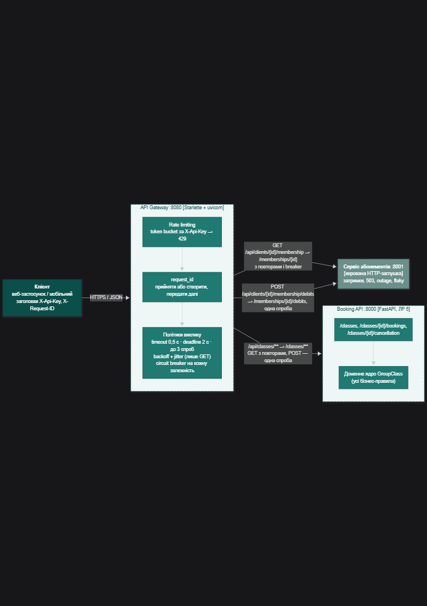
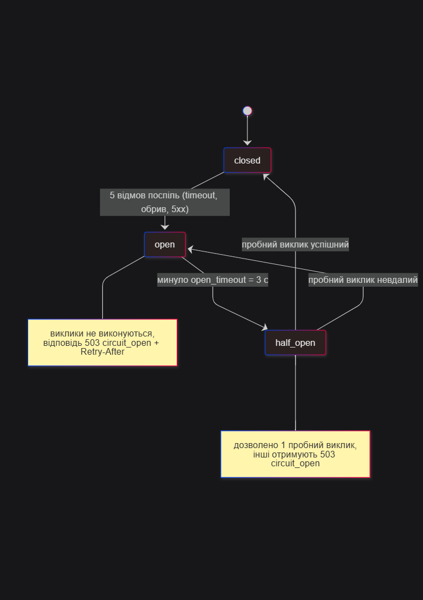

# Лабораторна робота №7 (модуль 2, ЛР 3). API Gateway та захист від каскадних відмов

Система: **FitShed**. Перед Booking API з ЛР 5 додано локальний шлюз. За ним — застосунок і керована HTTP-заглушка залежності «сервіс абонементів». Шлюз захищає систему від повільних відповідей, тимчасових помилок і перевантаження.

## 1. Компоненти, межі й маршрути



Вихідний файл: [`components.mmd`](components.mmd).

| Компонент | Порт | Технологія | Відповідальність |
|---|---|---|---|
| API Gateway | 8080 | Starlette + uvicorn | маршрутизація, `request_id`, rate limiting, таймаути, повтори безпечних читань, circuit breaker, однаковий формат помилок шлюзу |
| Booking API (ЛР 5) | 8000 | FastAPI | ресурс «групове заняття», перевірка структури запитів; бізнес-правила — у доменному ядрі |
| Сервіс абонементів | 8001 | керована заглушка на `http.server` | залежність, якій можна задати затримку, помилки або повну відмову; рахує фактичні виклики |

| Зовнішній маршрут шлюзу | Куди | Тип операції | Повтори |
|---|---|---|---|
| `GET /api/classes/...` | Booking API `/classes/...` | читання | так |
| `POST /api/classes`, `POST /api/classes/{id}/bookings`, `.../cancellation` | Booking API | зміна стану | ні, одна спроба |
| `GET /api/clients/{id}/membership` | сервіс абонементів `/memberships/{id}` | читання | так |
| `POST /api/clients/{id}/membership/debits` | сервіс абонементів `/memberships/{id}/debits` | зміна стану (списання) | ні, одна спроба |
| `GET /gateway/health`, `GET /gateway/state`, `POST /gateway/reset` | сам шлюз | службові | — |

**Чому шлюз на Starlette.** FastAPI побудований на Starlette. Для шлюзу не потрібні схеми запитів і генерація OpenAPI, бо шлюз нічого не перевіряє за змістом, а лише передає запити далі. Тому взято саму Starlette з тим самим сервером uvicorn. Порівняння з готовими шлюзами (Envoy, Kong, nginx) — в [ADR-006](../adr/ADR-006-gateway-resilience.md).

### Що лишилося в застосунку, а що перенесено в шлюз

| Шлюз | Booking API та доменне ядро |
|---|---|
| куди направити запит | чи коректний JSON запиту, типи й обов'язкові поля |
| скільки запитів дозволено клієнту (429) | чи є вільні місця, чи не записаний клієнт удруге |
| скільки чекати залежність і чи повторювати | чи дозволено скасувати заняття (переходи стану) |
| чи звертатися до залежності взагалі (breaker) | коди 400, 404, 409 і їх зміст |
| `request_id`, журнал спроб | — |

Шлюз не знає, що таке «заняття» чи «абонемент». Тест `test_domain_errors_come_from_api_not_gateway` перевіряє, що помилки 400 і 409 формує Booking API, а шлюз лише передає їх клієнту без повторів.

### BFF-вигляд для мобільного застосунку (опис, без реалізації)

Мобільному застосунку клієнта на екрані «Моє заняття» потрібні дані з двох місць: заняття (Booking API) і залишок абонемента (сервіс абонементів). Окремий BFF для мобільного клієнта міг би віддавати одну компактну відповідь `GET /bff/mobile/classes/{class_id}?client_id=...`:

```json
{
  "title": "Пілатес",
  "starts_at": "2026-12-02T10:00:00",
  "free_places": 2,
  "my_status": "booked",
  "can_cancel_without_penalty": true,
  "visits_left": 5,
  "membership": { "status": "ok", "as_of": "2026-12-01T09:00:00" }
}
```

- поля для екрана, а не всі поля ресурсу: без `trainer_id`, без повних списків записаних інших людей (так менше даних через мобільну мережу й менше чужих персональних даних);
- `can_cancel_without_penalty` розраховує сам BFF з часу початку (правило 3 годин з ЛР 2 він бере з API, а не дублює);
- якщо сервіс абонементів недоступний, BFF повертає решту даних, а в `membership` — `{"status": "unavailable"}` або застаріле значення з явною позначкою `"stale": true, "as_of": ...`. Тобто fallback явно позначено як частковий результат, а не видано за актуальний.

## 2. Політика повторів для операцій читання

Конфігурація: [`backend/config/gateway.json`](../../backend/config/gateway.json). Реалізація: [`resilience.py`](../../backend/src/fitshed/gateway/resilience.py), власна, перевірена модульними тестами з керованим «фальшивим» часом.

| Параметр | Значення | Пояснення |
|---|---|---|
| Таймаут однієї спроби | 0,5 с | заглушка у звичайному режимі відповідає за кілька мс; 0,5 с з великим запасом відрізняє «повільно» від «зависло» |
| Загальний deadline | 2,0 с | бюджет на всі спроби й паузи; клієнт отримує відповідь не пізніше ніж через ~2 с |
| Кількість спроб | до 3 (1 + 2 повтори) | більше спроб майже не підвищує шанс, але множить навантаження |
| Backoff | експоненційний: 0,1 → 0,2 → 0,4 с, не більше 1,0 с | кожна наступна пауза довша |
| Jitter | full jitter: випадкова пауза від 0 до верхньої межі | рознесення повторів різних клієнтів у часі |
| Остання спроба | отримує лише залишок deadline | наприклад, при 1,6 с витрачених спроба має не 0,5 с, а 0,4 с |

**Повтор дозволено** лише для операцій читання (`GET`) і лише за таких помилок:
- таймаут спроби;
- обрив або відмова з'єднання;
- HTTP **502, 503, 504**.

**Повтор заборонено** для:
- будь-яких операцій зміни стану (`POST`): шлюз не знає, чи виконалася дія, а політики ідемпотентності для них не узгоджено;
- **4xx** (помилка запиту від повтору не зникне);
- **500** (найімовірніше помилка в коді залежності, а не тимчасовий збій);
- відкритого breaker.

## 3. Circuit breaker і rate limiting



| Параметр breaker | Значення |
|---|---|
| Поріг відкриття | 5 відмов поспіль (таймаут, обрив, будь-який 5xx); кожна спроба рахується окремо |
| Час у стані open | 3 с |
| Проба в half-open | 1 виклик; успіх → closed, невдача → знову open |
| Відповідь у стані open | `503`, `code = circuit_open`, заголовок `Retry-After`, залежність не викликається |
| Окремий breaker | на кожну залежність: `booking_api` і `membership_service` |

| Параметр rate limiting | Значення |
|---|---|
| Алгоритм | token bucket |
| Ключ клієнта | заголовок `X-Api-Key`, без нього — IP-адреса |
| Ємність / відновлення | 20 запитів пачкою, 10 токенів за секунду |
| Відповідь понад ліміт | `429`, `code = rate_limited`, `Retry-After` |

**Журнал.** Шлюз пише кожну спробу (`request_id`, шаблон маршруту, номер спроби, результат, код, тривалість), підсумок запиту й кожен перехід стану breaker. У журнал **не** потрапляють `X-Api-Key` (лише хеш при 429), ідентифікатор клієнта з адреси (пишеться шаблон `/api/clients/{id}/membership`) і тіло запитів. Це перевіряє тест `test_request_id_is_propagated_and_logged_without_client_data`.

**request_id.** Шлюз приймає `X-Request-ID` від клієнта, якщо він безпечний (до 64 символів: латиниця, цифри, `.`, `_`, `-`), інакше створює новий. Він передається в залежність і повертається клієнту. Заглушка зберігає отримані `request_id`, тож видно, що вони дійшли.

## 4. П'ять сценаріїв

Скрипт [`checks.py`](../../backend/src/fitshed/gateway/checks.py) щоразу піднімає новий стенд (заглушка + шлюз на вільних портах), тож стан не переноситься між сценаріями. Кількість викликів залежності береться з лічильника самої заглушки. Повний вивід: [`checks.txt`](checks.txt), з журналом шлюзу: [`checks-with-log.txt`](checks-with-log.txt).

| № | Сценарій | Що задано заглушці | Код | Тривалість | Викликів залежності |
|---|---|---|---|---|---|
| 1 | Нормальна відповідь | normal | 200 | 240 мс | 1 |
| 2а | Зависання, повтор успішний | перший виклик зависає на 4 с | 200 | 640 мс | 2 |
| 2б | Повне зависання в межах deadline | усі виклики зависають на 6 с | 504 `upstream_timeout` | 1629 мс (< deadline 2 с) | 3 |
| 3а | Тимчасова помилка з повтором | 2 × 503, потім успіх | 200 | 342 мс | 3 |
| 3б | Не тимчасова помилка | 1 × 500 | 500 | 8 мс | 1 (без повтору) |
| 4 | Breaker: відкриття | outage 503 | 503, потім 503 | 169 мс, 210 мс | 3, 2 → breaker open |
| 4 | Breaker: стан open (5 запитів) | outage 503 | 503 `circuit_open` | 4–5 мс | **0** |
| 4 | Breaker: half-open після відновлення | normal, очікування 3 с | 200 | 30 мс | 1 (проба) → closed |
| 5 | Перевищення ліміту (ємність 5) | normal | 5 × 200, далі 3 × 429 | 200: 6–24 мс, 429: 3–4 мс | 5 (для 429 — 0) |

Деталі:
- **Сценарій 4.** Переходи стану: `closed → open → half_open → closed`. Доказ того, що в стані open залежність не викликалася: лічильник заглушки до й після п'яти відхилених запитів однаковий, у кожній відповіді `X-Upstream-Attempts: 0`, а час відповіді 4–5 мс. Для цієї перевірки ліміт запитів піднято до 1000, щоб 429 не сховав поведінку breaker.
- **Сценарій 5.** Інший клієнт (інший `X-Api-Key`) у той самий момент отримав 200: ліміт рахується окремо для кожного ключа. Відхилені запити до залежності не дійшли.

### Операція зміни стану не повторюється

| Ситуація | Код | Тривалість | Викликів залежності |
|---|---|---|---|
| Списання, залежність відповіла 503 | 503 | 33 мс | 1 |
| Списання, залежність не відповіла за 2 с | 504 `upstream_timeout` | 2023 мс | 1 |

Після другого випадку заглушка все одно завершила списання: лічильник списань змінився з 0 на 1. Тобто **таймаут не доводить, що дії не було**. Якби шлюз повторив запит, абонемент було б списано двічі. Тому відповідь 504 для операцій зміни стану має примітку «операцію не повторено, вона могла виконатися — перевірте стан перед повтором».

## 5. Серії з 30 запитів до й після захисту

Скрипт [`compare.py`](../../backend/src/fitshed/gateway/compare.py). «До захисту» — той самий шлюз у профілі `unprotected`: одна спроба, очікування до 10 с, без breaker. Ліміт запитів в обох серіях піднято, щоб він не впливав на результат. Запити послідовні. Повна таблиця: [`comparison.md`](comparison.md).

**Збій «нестабільна залежність»**: кожен 5-й виклик зависає на 2 с, кожен 3-й повертає 503.

| Показник | До захисту | Після захисту |
|---|---|---|
| Успішних (200) | 22 | **30** |
| Відмов | 8 (503) | **0** |
| Викликів залежності | 30 | **56** |
| Медіана часу, мс | 23 | 100 |
| Максимальний час, мс | 2080 | **805** |

**Збій «повна недоступність»**: кожен виклик повертає 503.

| Показник | До захисту | Після захисту |
|---|---|---|
| Успішних (200) | 0 | 0 |
| Відмов | 30 | 30 |
| Викликів залежності | 30 | **5** |
| Медіана часу, мс | 21 | 5 |
| Максимальний час, мс | 45 | 271 |

**Як це читати:**
- За нестабільної залежності повтори перетворили всі 8 відмов на успіх, а таймаут обмежив найдовше очікування з 2,1 с до 0,8 с. Ціна — **майже вдвічі більше викликів** залежності (56 замість 30) і вища медіана через повтори та паузи. Якщо залежність збоїть через перевантаження, ці додаткові виклики зроблять гірше.
- За повної недоступності повтори не допомагають, але breaker після 5 невдалих викликів перестав звертатися до залежності: 5 викликів замість 30. Залежність отримує час відновитися, а клієнти — швидку відмову. Максимальний час вищий через повтори першого запиту до відкриття breaker.

Числа отримано на одному комп'ютері (Windows, Python 3.14) з послідовними запитами. Вони показують **напрямок** впливу політик на цьому стенді й нічого не кажуть про доступність чи пропускну здатність реальної системи.

## 6. Перевірки й версії

| Інструмент | Версія |
|---|---|
| Python | ≥ 3.11 |
| Starlette | встановлюється разом з FastAPI |
| uvicorn | ≥ 0.30 |
| requests | ≥ 2.31 (HTTP-клієнт шлюзу) |
| FastAPI | ≥ 0.115 (Booking API з ЛР 5) |
| pytest | ≥ 8 |

Точні версії покаже `pip show starlette uvicorn requests fastapi`.

Автоматичні тести (з `backend`):
- `tests/test_resilience.py` — 12 модульних тестів політик із керованим часом;
- `tests/test_gateway.py` — 6 сценаріїв через справжній HTTP зі скороченими таймаутами, передавання `request_id` і відсутність ключа та ідентифікатора клієнта в журналі (8 тестів);
- `tests/test_gateway_booking.py` — шлюз перед справжнім Booking API на FastAPI (3 тести).

## 7. Порядок запуску й скидання стану

Встановлення (з `backend`, з активованим `.venv`):
```
pip install requests
```

**Сценарії й порівняння** — окремо нічого запускати не треба, стенд піднімається сам (з `backend/src`):
```
python -m fitshed.gateway.checks --save ../../docs/lab7/checks.txt
python -m fitshed.gateway.checks --log --save ../../docs/lab7/checks-with-log.txt
python -m fitshed.gateway.compare --save ../../docs/lab7/comparison.md
```

**Ручний запуск усієї системи** — три термінали, у кожному з `backend/src` з активованим `.venv`:
```
python -m fitshed.api.server                 # 1: Booking API на :8000
python -m fitshed.gateway.stub               # 2: сервіс абонементів на :8001
python -m fitshed.gateway.server             # 3: шлюз на :8080
```
Приклади (PowerShell):
```
Invoke-RestMethod http://127.0.0.1:8080/api/clients/anna/membership -Headers @{ "X-Api-Key" = "demo" }
Invoke-RestMethod -Method Post http://127.0.0.1:8001/__control -ContentType "application/json" -Body '{"mode":"outage","status":503}'
Invoke-RestMethod http://127.0.0.1:8080/gateway/state
```

**Скидання стану:**
- заглушка: `POST http://127.0.0.1:8001/__reset` (лічильники в нуль, режим normal);
- шлюз: `POST http://127.0.0.1:8080/gateway/reset` (усі breaker у closed, лічильники rate limiting очищено);
- Booking API: перезапуск (сховище в пам'яті).

Під час ручної перевірки breaker запускайте шлюз з `--rate-capacity 1000`, щоб ліміт запитів не сховав результат.

## 8. Обмеження

- Стан breaker і лічильники rate limiting зберігаються в пам'яті одного процесу шлюзу. Якщо запустити кілька копій шлюзу, кожна матиме свої лічильники, і загальний ліміт фактично збільшиться.
- Повтори виконуються лише для читань. Для безпечного повтору зміни стану потрібен ключ ідемпотентності (як `event_id` у ЛР 6), а він ще не узгоджений для HTTP API.
- Заглушка відтворює лише задані режими збою. Мережевих затримок, втрати пакетів і перевантаження CPU немає.
- Серії по 30 послідовних запитів не показують поведінки під паралельним навантаженням.

## 9. Висновок

Перед Booking API додано шлюз, який виконує лише спільні політики: маршрутизацію, `request_id`, rate limiting за ключем клієнта, таймаути, повтори безпечних читань і circuit breaker. Бізнес-правила лишилися в Booking API й доменному ядрі. Описано BFF-вигляд для мобільного застосунку з явно позначеним частковим результатом.

Для читань задано таймаут спроби 0,5 с, загальний deadline 2 с, до 3 спроб з експоненційним backoff і jitter. Повторюються лише таймаути, обриви з'єднання та 502/503/504. Операції зміни стану не повторюються: перевірка показала, що після таймауту списання все одно відбулося, тож повтор створив би дубль.

П'ять сценаріїв підтвердили роботу політик, зокрема те, що у стані open залежність не викликається (0 викликів, відповідь за 4–5 мс), а після відновлення breaker закривається через одну пробу. Порівняння серій показало компроміс: за нестабільної залежності повтори дали 30 успіхів замість 22, але майже вдвічі збільшили кількість викликів залежності, а за повної відмови breaker зменшив навантаження на залежність з 30 до 5 викликів. Вибір параметрів обґрунтовано в ADR-006.
