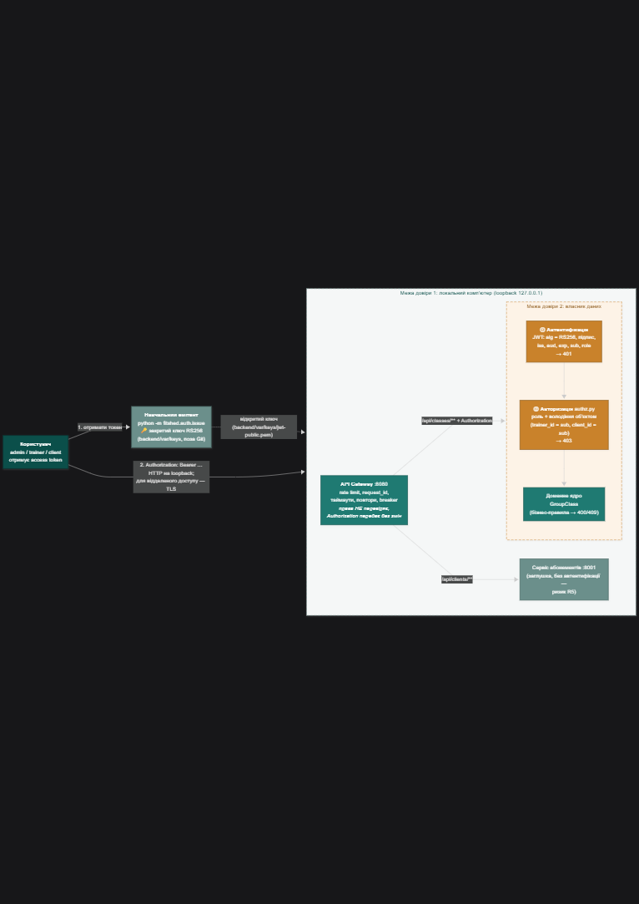

# Лабораторна робота №8 (модуль 2, ЛР 4). Контроль доступу та підсумкова оцінка архітектурних рішень

Система: **FitShed**. Booking API тепер приймає лише запити з перевіреним access token (JWT) і перевіряє не тільки роль, а й право на конкретне заняття. Друга частина роботи — підсумкова оцінка архітектури за сценаріями якості з урахуванням результатів ЛР 5–7.

## 1. Ролі, користувачі й володіння об'єктами

| Роль | Синтетичні користувачі (`sub`) | Що їй належить |
|---|---|---|
| `admin` | `admin-iryna` | нічого особисто; керує всім клубом |
| `trainer` | `trainer-olena`, `trainer-taras` (два користувачі з однаковою роллю) | заняття, де `trainer_id = sub` |
| `client` | `anna`, `bohdan`, `vira`, `halyna`, `dmytro` | власні записи, де `client_id = sub` |

Ролі відповідають ролям з ЛР 1 (адміністратор, тренер, клієнт).

## 2. Матриця доступу

| Операція | `admin` | `trainer` | `client` |
|---|---|---|---|
| **Створити заняття** `POST /classes` | дозволено для будь-якого тренера | лише якщо `trainer_id = sub` | 403 |
| **Читати заняття** `GET /classes/{id}` | дозволено, повні списки | дозволено; повні списки записаних — лише у **власному** занятті, у чужому списки порожні | дозволено; у списках записаних і очікування — **лише він сам** |
| **Записати клієнта** `POST /classes/{id}/bookings` | будь-кого | 403 | лише себе: `client_id = sub` |
| **Скасувати заняття** `POST /classes/{id}/cancellation` | будь-яке | лише **власне**: `trainer_id = sub` | 403 |
| Будь-яка операція без валідного токена | 401 | 401 | 401 |

Реалізація: [`backend/src/fitshed/api/authz.py`](../../backend/src/fitshed/api/authz.py).

**Чому для чужого заняття 403, а не 404.** Користувач уже автентифікований, а розклад занять у клубі не секретний (будь-хто може його прочитати), тож нема чого приховувати. 403 чесно пояснює, що бракує права, а не об'єкта.

## 3. Межі довіри й місця перевірки



Вихідний файл: [`trust-boundaries.mmd`](trust-boundaries.mmd).

1. **Шлюз** (ЛР 7) права **не** перевіряє. Він лише передає заголовок `Authorization` у Booking API без змін і не пише його в журнал. Перевірка в шлюзі не скасувала б перевірки у власнику даних: до Booking API можна звернутися й напряму, в обхід шлюзу.
2. **Автентифікація** в Booking API ([`auth/tokens.py`](../../backend/src/fitshed/auth/tokens.py)): токен перевіряється, а не просто декодується. Невдача дає **401**.
3. **Авторизація** в Booking API (`authz.py`): роль і володіння конкретним заняттям чи записом. Невдача дає **403**.
4. Лише після цього працює доменне ядро з бізнес-правилами (400, 409).

Стенд слухає лише `127.0.0.1` (loopback). Для віддаленого розгортання потрібен TLS, бо токен у заголовку інакше йде відкритим текстом.

## 4. JWT: що саме перевіряється

Бібліотека **PyJWT** з `cryptography`.

| Перевірка | Значення | Що буде, якщо не так |
|---|---|---|
| Алгоритм | лише **RS256**; `none`, HS256 та інші відхиляються ще до перевірки підпису | 401 «недозволений алгоритм» |
| Підпис | відкритий ключ емітента | 401 «підпис не збігається» |
| `iss` | `fitshed-local-issuer` | 401 «неочікуваний емітент» |
| `aud` | `fitshed-booking-api` | 401 «токен виданий для іншої аудиторії» |
| `exp` | не минув (допуск 10 с на розбіжність годинників) | 401 «строк дії токена минув» |
| Обов'язкові поля | `iss`, `aud`, `sub`, `iat`, `exp` | 401 |
| `role` | одна з `admin`, `trainer`, `client` | 401 |

- `sub` і `role` беруться **лише з перевіреного токена**. Значення з тіла запиту (`client_id`, `trainer_id`) порівнюються з ними, але ідентичність не задають.
- Ключі навчальні: пара RSA 2048 генерується локально командою `python -m fitshed.auth.keys` у `backend/var/keys/` (папка в `.gitignore`). Шляхи можна змінити змінними `FITSHED_JWT_PUBLIC_KEY` і `FITSHED_JWT_PRIVATE_KEY`. Booking API знає лише **відкритий** ключ, тож навіть з доступом до API токен підробити не можна.
- У payload немає секретів: його може розкодувати будь-хто. Там лише `iss`, `aud`, `sub`, `role`, `iat`, `exp`, `jti`.
- Емітент (`python -m fitshed.auth.issue`) — навчальна заміна OAuth 2.0 / OIDC-сервера. Він видає лише **access token** (`typ: at+jwt`). ID token з OIDC сюди не підходить: його аудиторія — клієнтський застосунок, а не API (див. відповіді на запитання).

## 5. Автоматичні перевірки доступу

[`tests/test_access.py`](../../backend/tests/test_access.py) — справжній HTTP через FastAPI. Стенд: заняття тренерки Олени, на яке записана Анна. Для заборонених дій стан заняття читається напряму з сервісу до й після запиту і порівнюється.

| Вимога завдання | Тест | Очікувано |
|---|---|---|
| Дозволений доступ | `test_owner_trainer_can_cancel_own_class`, `test_admin_can_cancel_any_class`, `test_client_books_self_and_reads_class` | 200 / 201 |
| Відсутній токен | `test_invalid_credentials_give_401_and_change_nothing[missing]` | 401, `WWW-Authenticate: Bearer`, стан не змінився |
| Змінений підпис | `…[bad-signature]` | 401, стан не змінився |
| Прострочений токен | `…[expired]` | 401, стан не змінився |
| Неправильна аудиторія | `…[wrong-aud]` | 401, стан не змінився |
| Неправильний емітент | `…[wrong-iss]` | 401, стан не змінився |
| Заборонена роль | `test_client_role_cannot_cancel_class_and_state_is_unchanged`, `test_trainer_role_cannot_book_clients` | 403, заняття досі `scheduled`, списки ті самі |
| Чужий об'єкт під тією самою роллю | `test_other_trainer_cannot_cancel_foreign_class_and_state_is_unchanged` (Тарас → заняття Олени), `test_client_cannot_book_on_behalf_of_other_client_and_state_is_unchanged` (Богдан → запис Віри), `test_trainer_cannot_create_class_for_other_trainer` | 403, стан не змінився |
| Додатково | 401 раніше за перевірку тіла запиту; інший тренер бачить заняття без імен клієнтів | — |

[`tests/test_tokens.py`](../../backend/tests/test_tokens.py) (20 тестів без HTTP) окремо перевіряє підробку вмісту (роль `client` замінена на `admin` без нового підпису), підпис іншим ключем, `alg: none`, атаку підміни алгоритму (HS256 з відкритим ключем як секретом), невідому роль і всі правила матриці доступу.

Інші тести ЛР 5 і ЛР 7 тепер теж працюють з токенами:
- **файл очікувань контракту** вказує, від імені кого виконується кожна взаємодія (`auth`);
- **тест клієнта** перевіряє, що клієнт надсилає `Authorization: Bearer`;
- **перевірка провайдера** використовує справжні токени;
- **тест шлюзу** показує, що 401 і 403 формує Booking API, а шлюз їх лише передає.

Усього в `backend/tests`: **150 тестів**.

## 6. Дерево якості

Пріоритет: (важливість для бізнесу, складність реалізації), H — висока, M — середня, L — низька.

```
Якість FitShed
├── Безпека
│   └── S1 (H, M) Ніхто не змінює чужі заняття й записи; невалідні токени відхиляються
├── Час відповіді
│   ├── T1 (H, M) Зависання залежності не затримує клієнта понад deadline
│   └── T2 (H, H) p95 ≤ 500 мс у вечірній пік (СЯ-3 з ЛР 1)
└── Стійкість до відмов
    ├── R1 (H, M) Повна відмова залежності не створює потоку викликів до неї
    └── R2 (H, H) Одночасний запис не перевищує місткість (СЯ-1 з ЛР 1)
```

| Сценарій | Умови | Вимірюваний критерій | Перевірка | Фактичний результат | Статус |
|---|---|---|---|---|---|
| **S1** Безпека | 8 видів спроб: без токена, не Bearer, змінений підпис, прострочений, чужа аудиторія, чужий емітент, заборонена роль, чужий об'єкт тієї самої ролі | 100 % спроб відхилено (401 або 403), стан заняття після кожної спроби не змінився | `test_access.py`, `test_tokens.py` | усі спроби відхилено з очікуваним кодом, знімки стану до й після однакові | **виконано** |
| **T1** Час відповіді | сервіс абонементів зависає на 6 с; шлюз з deadline 2 с | клієнт отримує відповідь ≤ 2,1 с | ЛР 7, сценарій 2б; серія «flaky» | 504 через 1629 мс; найдовша відповідь у серії з 30 запитів — 805 мс | **виконано** |
| **T2** Час відповіді під навантаженням | 100 одночасних користувачів, 80 % читань, 20 % записів | p95 ≤ 500 мс, помилок < 1 % | Locust (запланований у ЛР 1) | навантажувальний тест не виконувався; є лише послідовні серії по 30 запитів | **не перевірено** |
| **R1** Стійкість | сервіс абонементів повністю недоступний, 30 запитів | залежність отримує ≤ 5 викликів; відповідь у стані open ≤ 50 мс; після відновлення — closed через 1 пробу | ЛР 7, сценарій 4; серія «outage» | 5 викликів замість 30; 4–5 мс у стані open; переходи `closed → open → half_open → closed` | **виконано** |
| **R2** Стійкість даних | 20 одночасних записів на 3 вільні місця | записаних рівно 3 у 100 прогонах | паралельний тест (запланований у ЛР 1) | сховище в пам'яті без блокувань, тест не виконувався; у ЛР 2 це прямо записано як обмеження | **не перевірено** (очікувано **не виконано** для поточного сховища) |

**Чого бракує для висновку щодо T2 і R2.** Потрібне справжнє сховище (PostgreSQL з блокуванням рядка), запуск кількох паралельних клієнтів (Locust або тест з `asyncio`/потоками) і стенд, схожий на розміщення з ADR-003. Без цього можна лише сказати, що за **послідовних** запитів правила виконуються.

## 7. Реєстр архітектурних ризиків

| № | Ризик | Наслідок | Як перевірити | Як зменшити | Стан |
|---|---|---|---|---|---|
| R1 | Одночасний запис на останнє місце: сховище в пам'яті не має блокувань (ЛР 2) | двоє клієнтів займають одне місце, СЯ-1 порушено | паралельний тест: 20 записів на 3 місця, 100 прогонів | адаптер PostgreSQL з `SELECT … FOR UPDATE` або оптимістичним блокуванням | відкритий |
| R2 | Втрата події між скасуванням заняття й публікацією в RabbitMQ (ЛР 6, ADR-005) | клієнтам не повертаються відвідування | точка збою між `cancel_class` і `basic_publish` | transactional outbox у тій самій транзакції, що й зміна заняття | відкритий |
| R3 | Повтори посилюють навантаження на залежність, яка вже деградує | лавина повторів, довше відновлення | серії ЛР 7 і зміна `max_attempts` (розділ 8) | обмежені спроби, backoff з jitter, deadline, breaker | **перевірено дослідом**: повтори додають +87 % викликів при 3 спробах, +47 % при 2 |
| R4 | Компрометація закритого ключа емітента | будь-хто випускає токени з роллю `admin` | аудит, де лежить ключ і хто має до нього доступ | ключ поза Git, лише в емітента; API має тільки відкритий ключ; короткий строк дії (15 хв). Ротації ключів (`kid`) поки немає | частково зменшено |
| R5 | Сервіс абонементів не перевіряє токени | хто в локальній мережі, той може списувати відвідування в обхід шлюзу | запит напряму на `:8001` | автентифікація між сервісами (mTLS або токени для сервісу), мережева ізоляція | прийнятий для навчальної заглушки |
| R6 | Стан breaker і rate limiting у пам'яті одного процесу шлюзу (ЛР 7) | при кількох копіях шлюзу ліміт фактично множиться | запустити дві копії й порахувати пропущені запити | спільне сховище лічильників (Redis) або готовий шлюз | прийнятий для однієї копії |

## 8. Точка чутливості, компроміс і зміна параметра

**Точка чутливості — кількість спроб `max_attempts` для читань.** Від одного числа одночасно залежать частка успішних відповідей і навантаження на залежність.

**Дослід.** У конфігурації ЛР 7 змінено лише `max_attempts` з 3 на 2 і повторено ту саму серію з 30 запитів за тих самих збоїв. Команда: `python -m fitshed.gateway.compare --vary max_attempts=2`. Результат: [`param-change.md`](param-change.md).

| Нестабільна залежність | `max_attempts = 3` | `max_attempts = 2` |
|---|---|---|
| Успішних відповідей | 30 | **24** |
| Відмов | 0 | 6 (3 × 503, 3 × 504) |
| Викликів залежності | 56 | **44** |
| Медіана, мс | 84 | 3 |
| Максимум, мс | 762 | 597 |

| Повна недоступність | `max_attempts = 3` | `max_attempts = 2` |
|---|---|---|
| Викликів залежності | 5 | 5 |
| Максимум, мс | 206 | 92 |

**Чому результат змінився.** У серії «flaky» деякі запити влучають у дві невдалі спроби поспіль: 503, а потім зависання. З трьома спробами третя їх рятує, з двома запит закінчується помилкою. Звідси 6 відмов. Водночас кожна врятована відповідь коштувала додаткового виклику, тож при двох спробах викликів на 21 % менше, а медіана падає, бо менше запитів чекають на паузи між повторами. За повної недоступності кількість викликів не змінилася (5): breaker відкривається після п'яти невдалих викликів незалежно від того, як вони розподілені між запитами. Змінився лише час перших запитів.

**Компроміс, підтверджений дослідом:** шанс успіху ↔ навантаження на залежність ↔ час відповіді. Третя спроба дає +6 успішних відповідей (+25 %) ціною +12 викликів (+27 %). Для FitShed, де читання абонемента дешеве, а відмова помітна клієнту, обрано **залишити 3 спроби**. Рішення й умову перегляду зафіксовано в [ADR-008](../adr/ADR-008-resilience-after-evaluation.md), який замінює ADR-006.

Числа отримано на моєму стенді; на іншому комп'ютері мілісекунди будуть іншими, а кількість успіхів і викликів збігатиметься, бо збій детермінований.

## 9. Підсумкові ADR і зіставлення з першим модулем

| ADR | Що вирішено | Стан після оцінки |
|---|---|---|
| [ADR-001](../adr/ADR-001-modular-monolith.md) Модульний моноліт (ЛР 1) | моноліт, окремий воркер; черга завдань у PostgreSQL замість брокера | **частково замінено ADR-005**: обмін подіями між контекстами йде через RabbitMQ. Моноліт і воркер — без змін |
| [ADR-002](../adr/ADR-002-booking-saga.md) Saga (ЛР 3) | оркестрована Saga «місце → абонемент» | без змін |
| [ADR-003](../adr/ADR-003-deployment.md) Розміщення (ЛР 4) | одна VM з Docker Compose | без змін: шлюз і RabbitMQ — ще два контейнери на тій самій VM. Ризики R4–R6 підсилюють умову переходу на B |
| [ADR-006](../adr/ADR-006-gateway-resilience.md) Шлюз і стійкість (ЛР 7) | параметри повторів, breaker, rate limit | **замінено ADR-008** |
| [ADR-007](../adr/ADR-007-access-policy.md) Політика доступу (ЛР 8) | JWT RS256, перевірка в Booking API, роль + володіння | **новий** |
| [ADR-008](../adr/ADR-008-resilience-after-evaluation.md) Стійкість після оцінки (ЛР 8) | 3 спроби підтверджено дослідом, тригери перегляду в числах | **новий**, замінює ADR-006 |

## 10. Відтворення демонстрації без реальних секретів

Усі облікові дані синтетичні, ключі створюються локально й у Git не потрапляють. Команди з `backend/src`, з активованим `.venv`:

```
pip install "pyjwt[crypto]"

python -m fitshed.auth.keys                                    # навчальні ключі → backend/var/keys
python -m fitshed.auth.issue --sub trainer-olena --role trainer   # отримати токен (виводиться в консоль)
```

Демонстрація через API — два термінали:
```
python -m fitshed.api.server          # 1: Booking API на 127.0.0.1:8000
python -m fitshed.api.scenario        # 2: сценарій від імені різних користувачів
```
Сценарій показує дозволені дії, 403 для запису іншого клієнта й для скасування чужого заняття, 401 без токена, різний вигляд заняття для тренерки й клієнтки.

Ручна перевірка (PowerShell):
```
$t = python -m fitshed.auth.issue --sub trainer-taras --role trainer
Invoke-RestMethod http://127.0.0.1:8000/classes/<id> -Headers @{ Authorization = "Bearer $t" }
```

Тести (з `backend`):
```
python -m pytest tests/test_tokens.py tests/test_access.py
python -m pytest                      # усі 150
```

Дослід з параметром (з `backend/src`):
```
python -m fitshed.gateway.compare --vary max_attempts=2 --save ../../docs/lab8/param-change.md
```

## 11. Висновок

Для FitShed визначено три ролі (адміністратор, тренер, клієнт) з двома користувачами однакової ролі та правила володіння: заняття належить тренеру, запис — клієнту. Матриця доступу задає умови для читання, запису й скасування. Права перевіряє Booking API як власник даних, а шлюз лише передає токен. Access token перевіряється бібліотекою PyJWT за алгоритмом RS256, підписом, емітентом, аудиторією й строком дії. Ідентичність береться лише з перевіреного токена. Автоматичні тести підтвердили 401 для відсутнього, підробленого, простроченого токена й токена з чужою аудиторією чи емітентом, а також 403 для забороненої ролі й чужого заняття, причому стан заняття не змінився.

Дерево якості містить сценарії безпеки, часу відповіді та стійкості. Три з них виконано за даними ЛР 7–8, а навантаження в пік і одночасний запис лишилися неперевіреними, бо для них потрібні PostgreSQL і паралельний стенд. Реєстр містить шість ризиків. Точку чутливості `max_attempts` перевірено дослідом: зменшення з 3 до 2 спроб скоротило виклики залежності на 21 %, але дало 6 відмов із 30. Тому 3 спроби залишено й зафіксовано в ADR-008, який замінює ADR-006. Політику доступу оформлено в ADR-007, а ADR-001 позначено як частково замінений ADR-005.
